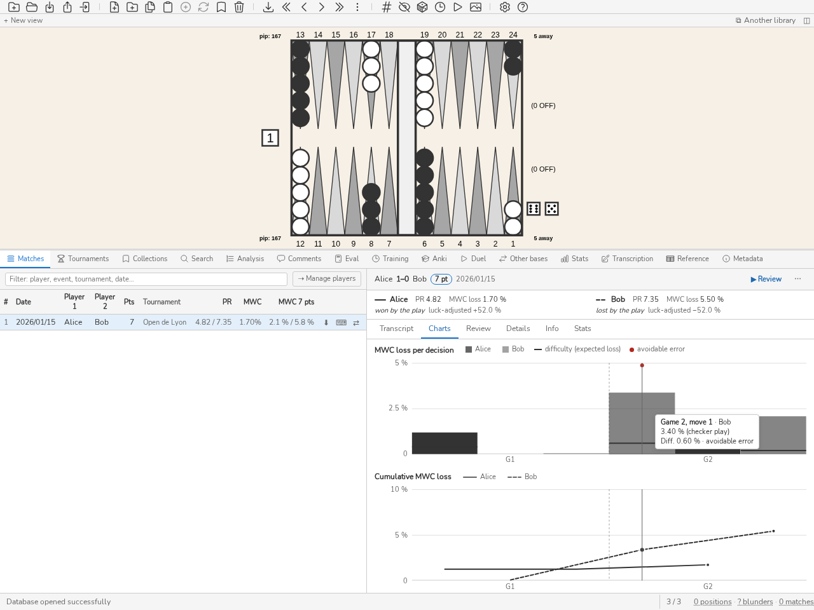

.. _manuel_matchs:

Matchs et transcription
=======================

.. _panneau_matchs:

Panneau Matchs
--------------

Le panneau **Matchs** (*CTRL-Tab*) liste les matchs importés. Double-cliquer
sur un match (ou appuyer sur *ENTREE*) pour naviguer dans ses coups. La
commande ``m`` reprend la navigation dans le dernier match visité.

Le champ de filtre, en haut du panneau (*/* pour y aller, *Esc* pour
l'effacer), ne garde que les matchs dont un joueur, l'événement, le lieu, le
tournoi ou la date contient le texte saisi. Le filtre et le tri des colonnes
sont faits par la base : la liste se charge par pages au fil du défilement, et
le compteur « n / N matchs » indique la part chargée. Corriger un joueur, une
date ou un tournoi dans la liste ne met à jour que la ligne éditée.

Quand la liste est vide, le panneau propose **Importer… (Ctrl+I)** ; sans base
ouverte, il propose **Ouvrir une base…** à la place, avec **Retour à
l'accueil**. Quand c'est le filtre de texte qui a vidé la liste, il propose
**Effacer le filtre**. Les panneaux Stats, Collections et Anki vides offrent les
mêmes boutons.

L'utilisateur peut:

* parcourir les coups d'un match en utilisant les touches *GAUCHE* et *DROITE*,

* passer d'une partie à l'autre à l'aide des touches *PageUp* et *PageDown*,

* afficher l'analyse des coups (pions et cube) en appuyant sur *CTRL-L*,

* basculer entre l'analyse des coups de pions et du cube avec la touche *d*,

* voir le coup effectivement joué mis en évidence dans l'analyse,

* chercher parmi les positions du match avec la commande ``ss`` (ex:
  ``ss E>80``) ; *Esc* ramène ensuite au coup étudié (voir
  :ref:`panneau_recherche`).

La dernière position visitée dans chaque match est mémorisée et restaurée
automatiquement. Appuyer sur *CTRL-Tab* ou exécuter la commande ``match``
pour afficher ou masquer le panneau.

Le bouton **⊕** d'une ligne enrichit ce match depuis un fichier. Il n'y a rien
de nouveau derrière : réimporter le même match dans un autre format
l'enrichit déjà en place — l'empreinte canonique reconnaît qu'il s'agit du
même match, et les analyses et commentaires du second fichier viennent
compléter le premier. Ce que le bouton apporte, c'est qu'on le trouve :
personne ne devine qu'un import est aussi un enrichissement. Le compte rendu
qui suit dit lequel des deux a eu lieu — « enrichis : 1 » plutôt que
« importés : 1 ».

Chaque match peut être exporté en transcription Jellyfish ``.mat`` via le
bouton ⬇ de la liste des matchs ou l'entrée *Exporter en .mat* du menu ⋯ de la
fiche du match.

Un clic sur un match ouvre sa fiche. Une ligne
d'en-tête donne les joueurs, le score final (le vainqueur en gras, son nom au
survol), la longueur, la cadence s'il y en a une et la date ; le tournoi, la
ronde et le lieu s'affichent au survol. À droite, l'icône 🎞 d'un match qui a
une vidéo, le bouton **Revoir** et le menu ⋯, qui porte *Exporter en .mat*,
*Éditer la transcription* et *Supprimer le match*. Vient ensuite la
synthèse du :ref:`bilan du match <bilan_match>`, puis une barre d'onglets :
**Transcription**, qui liste les coups partie par partie (un clic sur un coup y
amène la revue), **Graphes**, **À revoir**, **Détails**, **Infos** et **Stats**.
L'onglet choisi occupe toute la hauteur restante du panneau et défile seul,
l'en-tête et la synthèse restant en place ; quand un onglet a le focus, les
flèches gauche et droite passent au précédent ou au suivant. L'onglet laissé ouvert l'est encore au match suivant. Un
onglet sans contenu n'apparaît pas : un match sans analyse n'a ni **À revoir**
ni **Détails**, un match sans perte ni durée connue n'a pas de **Graphes**.

   La fiche d'un match : l'en-tête, la synthèse du bilan par joueur, puis
   l'onglet *Graphes*, une décision survolée.

Chaque coup de la transcription porte sa **gravité** : ``?`` pour une erreur, ``??`` pour un blunder, un filet de
couleur en marge de la ligne, et le coût du coup en équité au survol de la
marque. Les seuils sont ceux de la base (:ref:`configuration`), ceux que
comptent les statistiques. Le coup est jugé tel qu'il a été joué : une même
position jouée deux fois dans le match reçoit deux jugements. Un coup que
l'analyse ne note pas ne porte aucune marque.

L'en-tête de chaque partie compte ses marques, qu'elle soit dépliée ou non :
on voit sans l'ouvrir dans quelle partie se trouvent les blunders. Un clic sur
un compte charge ces positions dans le panneau d'analyse.

Quand le match est analysé, la transcription ajoute la colonne **MWC**, les chances de
gagner le match que la décision a coûtées, en pourcentage : ``0`` pour une
décision sans perte, un tiret pour une décision que l'analyse ne note pas ou
dont le score n'a pas de valeur dans la table d'équité du match (jeu en
money, décision hors statistiques). Un clic sur l'en-tête **MWC** trie les
coups de chaque partie de la perte la plus lourde à la plus légère, puis
l'inverse, puis rend l'ordre du match ; les décisions non notées passent en
dernier, et ce tri remplace celui de la durée. L'onglet **Graphes** montre
deux graphiques en pleine largeur sur l'axe de décisions de celui des durées :
une barre par décision, puis la perte cumulée de chaque joueur, qui s'arrête
sur son total (trait plein pour le premier joueur, pointillé pour le second).
Chaque graphique a son titre, sa légende, son échelle à gauche et, sous l'axe,
le numéro de chaque partie (P1, P2…), un trait pointillé marquant le passage
d'une partie à la suivante. Une décision non notée porte un
petit repère à la base de la barre, sans hauteur. Survoler une décision, ou la
parcourir avec les flèches (les touches Début et Fin mènent aux extrémités), la marque sur tous les
graphiques et sur sa ligne de la transcription, et une info-bulle donne la
partie, le coup, le joueur et la perte ; l'info-bulle se place du côté où elle
tient entière dans le cadre du graphique, même dans un panneau étroit. Un clic,
ou Entrée, y amène la revue. Il en va de même pour le graphique des
durées. Dans la légende de chaque graphique, le nom de chaque joueur est une
case à cocher (au clavier comme à la souris) : la décocher masque ses marques
sur les trois graphiques, car le réglage est commun, et le survol, le clic et
les flèches ne tombent plus que sur les décisions de l'autre joueur (un clic
prend la décision visible la plus proche). Le dernier joueur coché ne se
décoche pas, et chaque match s'ouvre avec les deux joueurs cochés. Hors de l'interface, ``match --format json`` ajoute ``decision_losses``
(une entrée par coup, ``mwc_loss`` valant ``null`` pour un coup non noté),
``--format text`` une ligne « MWC loss » par coup noté et ``--format summary`` le
total par joueur.

**Difficulté et erreurs évitables.** Une perte dit ce qu'un coup a coûté, pas
s'il était difficile de trouver le bon. La colonne **Diff.**, à côté de
**MWC**, donne la *difficulté* de la décision : la perte de chances de gagner
le match qu'un *joueur de référence* subirait en moyenne dans la même position.
Ce joueur de référence ne joue pas parfaitement : il choisit chaque option avec
une probabilité d'autant plus faible qu'elle coûte cher, π(i) proportionnelle à
exp(−Δᵢ/τ), où Δᵢ est le coût de l'option i par rapport à la meilleure, en
équité normalisée. La difficulté vaut d = Σ π(i)·Δᵢ, convertie en MWC au score
et au videau de la décision comme la perte : elle s'exprime dans la même unité,
un pourcentage de chances de gagner le match. Les options sont les candidats de
l'analyse pour un coup de pions ; pas de double et double (contre la meilleure
réponse) pour qui a le videau ; prendre et passer pour qui reçoit le double.
La température τ vaut 0,025 : la décision à deux options la plus difficile est
celle dont l'écart est d'environ 0,032, et une position à cinq candidats espacés
de 0,01 donne l'erreur moyenne d'un joueur de PR 6 environ ; c'est un a priori
de joueur fort, fixé avant tout examen de résultats.

À lire ainsi : une décision évidente, ou forcée, a une difficulté proche de
``0`` sans qu'aucun seuil la mette à part ; une décision serrée, où plusieurs
options se tiennent à quelques millièmes, en a une grande. Une perte bien
supérieure à la difficulté est une faute que la position n'excusait pas ; une
perte proche de la difficulté, une faute qu'un bon joueur ferait aussi. Une
décision est une **erreur évitable**, marquée d'un ``!`` à côté de sa perte et
d'un point au-dessus de sa barre, quand sa perte atteint le seuil d'erreur de la
base et que sa difficulté n'en dépasse pas le dixième : sur une décision à deux
options, le joueur de référence ne la commettrait pas une fois sur dix. Sur le
graphique par décision, la difficulté est un trait horizontal sur chaque barre :
une barre qui monte loin au-dessus de son trait signale une erreur évitable.

Le tableau de l'onglet **Détails** donne, pour chaque joueur, sa perte MWC
totale (celle de la liste des matchs), le nombre de décisions notées et, sur les
décisions qui ont une perte et une difficulté : la **difficulté** totale,
l'**excès** Σ(perte − difficulté), en MWC, ce que le joueur a perdu au-delà du
joueur de référence (négatif quand il a fait mieux), le **ratio** perte totale /
difficulté totale (1 : il joue comme le joueur de référence ; 2 : il perd deux
fois plus) et le nombre d'**erreurs évitables**. Le ratio n'est pas donné quand
la difficulté totale est sous 0,5 % : sur un match trop facile il ne mesurerait
que du bruit, l'excès reste.

Pourquoi la regarder : le PR et la perte MWC mêlent deux choses, la qualité du
jeu et la difficulté des positions rencontrées. Un adversaire qui crée des
positions complexes fait monter l'erreur de l'autre ; un match de course pure la
fait baisser. La difficulté corrige ces deux effets : l'excès et le ratio
comparent le joueur à ce qu'on pouvait attendre dans *ses* positions. Pour
l'étude, elle trie les fautes : les erreurs évitables sont de l'inattention ou
une règle mal sue, à revoir en premier et souvent faciles à corriger ; les
pertes sur des décisions difficiles relèvent du travail de fond (rollouts,
principes, positions de référence) et pèsent moins sur le jugement d'un match.

Incertitude et limites : la difficulté dépend d'un modèle de joueur et de τ,
fixés une fois ; changer l'un change tous les chiffres. Elle ne connaît que les
candidats que l'analyse a gardés (quelques-uns chez XG, selon ses filtres chez
GNU Backgammon) : les options absentes ne pèsent rien et la difficulté est
alors un minorant. Elle hérite de l'erreur de l'analyse elle-même, surtout à
faible profondeur. Sur un seul match, l'excès et le ratio reposent sur peu de
décisions et varient beaucoup d'un match à l'autre : ils indiquent une
tendance, pas un classement. La difficulté n'est calculée que pour les décisions
dont la perte est notée ; ailleurs elle vaut un tiret. Hors de l'interface,
``match --format json`` porte ``difficulty`` et ``avoidable`` sur chaque entrée
de ``decision_losses`` et le résumé par joueur sous ``difficulty_summary`` ;
``--format text`` ajoute les lignes « Difficulty » et « Avoidable error »,
``--format summary`` la difficulté, l'excès, le ratio et le nombre d'erreurs
évitables.

.. _bilan_match:

**Bilan du match.** Le bilan répond, pour chaque joueur, aux trois questions
qu'on se pose après un match : qu'est-ce que je revois, ai-je perdu à cause des
dés ou du jeu, et mes erreurs viennent-elles de la précipitation ou d'une
lacune ? Les seuils ont été fixés avant tout examen de résultats.

En tête de la fiche, au-dessus des onglets, une synthèse place les joueurs
côte à côte (l'un sous l'autre quand le panneau est étroit) : le nom, avec le
trait qui le désigne sur le graphique cumulé, le PR, la perte MWC du match et,
pour un match terminé, le verdict de la chance en clair (« gagné par le jeu »,
« perdu par les dés »…) suivi du seul résultat ajusté. Le survol du PR donne son
intervalle ; celui du verdict, les composantes du résultat ajusté. Le reste
se répartit entre deux onglets : **Détails** donne les intervalles, la perte
ramenée à 7 pts et la chance ; **À revoir**, les décisions à revoir et le
partage des erreurs entre précipitées et réfléchies :

* **PR et perte de MWC ramenée à 7 pts, avec leur intervalle à 95 %**, calculé
  en rééchantillonnant les parties du match. La perte ramenée à 7 points est
  la perte du match mise à l'échelle d'un match en 7 points (L₇, voir
  :doc:`metriques`) : elle sert à comparer des matchs de longueurs
  différentes, la synthèse ne montre que la perte du match lui-même. Il faut trois parties ; un match plus
  court montre un tiret. Un intervalle large dit qu'un match ne suffit
  pas à juger un niveau : comparez-le à vos autres matchs plutôt que de
  conclure sur une valeur.
* **Résultat ajusté de la chance**, pour un match terminé. Le *résultat* est
  l'issue (100 % gagné, 0 % perdu) moins les chances au départ (50 % à 0-0) ; la
  *chance nette* additionne la chance de vos jets moins celle des jets adverses,
  chaque jet converti en MWC au score et au videau de sa position, comme une
  perte. Le résultat ajusté est le résultat moins la chance nette. S'il est
  positif sur un match perdu, ce sont les dés qui l'ont décidé ; négatif, c'est
  le jeu. L'*écart des erreurs* (perte de l'adversaire moins la vôtre) est ce que
  le résultat ajusté estime : les deux chiffres se recoupent quand la chance est
  complète. La couverture est indiquée quand des jets n'ont pas de chance
  mesurée (un fichier sans chance, un jet non analysé) ; sans aucun jet mesuré,
  ou pour une partie d'argent, la ligne n'apparaît pas.
* **Trois décisions à revoir** : parmi vos erreurs (seuil de la base), celles
  dont la *part évitable* de la perte, perte − difficulté, est la plus grande —
  c'est-à-dire la perte multipliée par son caractère évitable. Une erreur que le
  joueur de référence aurait faite aussi ne vaut pas une séance : on revoit
  d'abord ce qui était à sa portée. Un clic sur la décision l'affiche, comme une
  ligne du relevé.
* **Erreurs précipitées et réfléchies**, quand le match a gardé la durée des
  décisions : une erreur jouée plus vite que la médiane de vos décisions du même
  type (pions ou videau) dans ce match est précipitée, les autres réfléchies. La
  médiane est la vôtre, dans ce match : elle ne dépend pas de la cadence, et
  sans lien entre vitesse et erreur les erreurs se partageraient moitié-moitié.
  Une majorité précipitée appelle de la discipline (ralentir sur ces positions) ;
  une majorité réfléchie, de la connaissance (étudier la famille de positions).

L'onglet **Détails** se termine sur le tableau des pertes et de la difficulté
décrit plus haut. ``match --format summary`` imprime le même bilan, et le serveur le
sert par ``/v1/stats.matchReview``.

Quand le match a gardé la durée de ses décisions (un match joué contre un bot),
la transcription ajoute trois colonnes alignées sur les chiffres : **Videau** (la
décision de videau, prise avant le lancer ou sur la ligne du videau elle-même),
**Jeu** (le coup de pions) et **Horloge**, le temps que le joueur au trait a
consommé depuis le début du match, ce coup compris, quel que soit le tri. Sous
une cadence, la colonne devient **Pendule** et donne le temps qui reste à la
pendule du joueur après le coup, calculé comme l'arbitre du Duel le compte (délai
par tour, réserve ramenée à zéro au dépassement). Les informations du match et
son en-tête rappellent la cadence (préréglage, délai, comportement au
dépassement) et la banque de temps de chaque joueur, ramenée au score de départ
quand la réserve est comptée par point restant. Un clic sur l'en-tête **Jeu** trie les coups de chaque partie du plus long
au plus court, puis du plus court au plus long, puis rend l'ordre du match ; une
case sans durée (pas de décision de videau à ce tour, ou coup joué par
l'Arbitre seul) porte un tiret, et ces coups passent en dernier. L'Horloge
part de zéro dès le premier coup. L'onglet **Graphes** commence par un résumé
qui donne pour chaque joueur le total, la moyenne par coup de pions et par décision
de videau, et, si le match a une cadence, une marque pour le joueur dont la
réserve s'est épuisée en premier (le Duel n'enregistre que celui-là) ; un
graphique place la durée
de chaque décision au fil du match. En revue, la durée de la décision jouée se
lit discrètement sous l'analyse. La recherche la filtre avec ``tm>30`` (en
secondes), qui se combine avec ``E>x`` : ``s tm>30 E>80`` retient les coups
longuement réfléchis et pourtant faux, la durée et l'erreur étant celles du
même coup joué. L'onglet **Stats**, sous les erreurs récurrentes, croise
le temps et l'erreur : pour chaque joueur et chaque tranche de durée connue
(moins de 5 s, 5 à 15 s, 15 à 30 s, plus de 30 s), le nombre de décisions,
l'erreur moyenne et la part de blunders. Une décision dont l'erreur n'est pas
enregistrée est comptée sans entrer dans la moyenne.

La colonne **Positions** compte les positions distinctes de ces décisions et
les ouvre d'un clic. Le tableau et ses liens lisent toutes les décisions
chronométrées de la base, sans le filtre du panneau.

Un match joué ici, issu d'un Duel, porte son origine dans l'onglet **Infos** de
sa fiche, sous le titre **Provenance**, sur une ligne, même s'il n'a aucun coup : « Joué ici », puis,
s'il y a lieu, « Perdu au temps » avec le joueur dont la réserve s'est épuisée
sous une cadence qui fait perdre le match, ou « Arrêté avant la fin » pour un
Match qu'un Duel arrêté a laissé inachevé, la cadence, le joueur dont la réserve s'est épuisée en premier et
le niveau du Bot avec la version de gammonNet dont il a joué la politique. Un
clic déplie le départ (la position initiale ou le XGID choisi), le germe des
dés révélé et son SHA-256, à comparer avec l'empreinte publiée à la création
du Duel : s'ils concordent, le germe permet de recalculer chaque lancer sans
faire confiance à blunderDB. Un match qui n'a pas été joué ici n'a pas
d'origine, et son onglet **Infos** n'a pas ce titre.

L'onglet **Infos** de la fiche rappelle l'en-tête du match. Il y ajoute ce que
le fichier source dit des joueurs et de la session, quand il le dit — un
fichier eXtreme Gammon le dit toujours : le classement Elo de chaque joueur et
son expérience entre parenthèses, le transcripteur, les règles Jacoby et Beaver
d'une partie libre, et le programme qui a écrit le fichier. Ces informations
sont exportées avec le match. Réimporter un fichier déjà présent les donne au
match qui ne les avait pas, sans rien remplacer de ce qu'il porte déjà. La
commande ``match`` de la ligne de commande les affiche aussi. Les commentaires
d'en-tête et de pied de match d'un fichier eXtreme Gammon deviennent le
commentaire du match, signé du nom de son transcripteur, ou ``XG`` si le fichier
n'en nomme pas ; l'horloge et la table d'équité ne sont pas importées. La
fiche affiche cet auteur à côté du commentaire, et l'export le copie avec lui ;
modifier le commentaire le signe de **Votre nom** (réglages).

La ligne **Fichier source** porte le bouton ⟲ quand le match en nomme un : il
relit ce fichier et réécrit les positions, les analyses et les erreurs du match
comme un import neuf, en gardant tout ce qui a été saisi depuis (tournoi, noms,
inversion des joueurs, commentaires, transcription, vidéo et repères) et les
analyses plus profondes que celles du fichier. Un match
conforme à son fichier le dit dans la barre d'état ; sinon une confirmation
donne le nombre de coups qui changent de position et la part de coups analysés
avant et après ; la barre d'état compte ensuite les commentaires restés sur une
position qu'une collection, une carte ou une leçon garde. La réparation est
refusée quand le fichier est introuvable, ne contient plus ce match, ou quand
ses coups ne disent pas quel joueur du fichier est lequel. La commande ``match repair`` fait la même chose, et
``match repair --list`` trouve les matchs qui diffèrent de leur fichier.

Un match transcrit depuis une vidéo en porte la **source** : une URL http(s)
(YouTube, par exemple) ou le chemin d'un fichier. La ligne **Vidéo** de la section
**Infos** la modifie : saisir une URL ou un chemin puis *ENTREE*, **Fichier…**
pour choisir une vidéo, **Détacher** pour retirer la source. Un match qui en a
une affiche l'icône 🎞 dans l'en-tête de sa fiche, et chaque décision qui porte
un repère de la vidéo la même icône dans sa ligne de la transcription.
Cliquer l'icône, ou appuyer sur *v* quand la décision est celle de la revue,
amène la vidéo une seconde avant le jet des dés : pour un fichier, la vidéo
s'ouvre à côté du plateau, ou au-dessus de la fiche si elle a été remise dans
le panneau, et *[* et *]* en règlent la
vitesse ; pour une source YouTube, le navigateur s'ouvre sur le lien horodaté. Un fichier introuvable se relocalise depuis le
volet, et un format que le webview ne lit pas y est signalé avec les paquets à
installer (voir :ref:`telecharge_install`). Un match sans source ne change pas.

Le bouton **Gérer les joueurs** de la barre d'outils du panneau ouvre une
fenêtre listant tous les joueurs de la base, chacun avec son nombre de matchs
(cliquer le nombre affiche ses matchs dans le panneau) et ses alias. Pour
fusionner, sélectionner les variantes d'orthographe d'un même joueur, choisir le
nom canonique à conserver (le taper, ou cliquer ✓ sur sa ligne), puis fusionner. La fenêtre reste ouverte pour enchaîner d'autres fusions ; **Fermer** (ou *Échap*) la referme. La fusion crée un alias par
variante : les matchs gardent les noms de leurs fichiers, mais les statistiques,
la table Joueurs et la recherche ``pl"…"`` lisent toutes les variantes comme un
seul joueur, et les imports suivants enregistrent le nom canonique. Cliquer un
alias (*×*) le retire et défait la fusion, comme dans l'onglet **Corpus** des
paramètres.

.. _joueur_principal:

L'étoile (☆) d'une ligne désigne le **joueur principal**, celui à qui appartient
la base, mémorisé dans la base et toujours en tête de la liste. Elle se remplit
aussitôt et affiche le nombre de matchs où il est joueur 2 (cliquable, pour les
voir), puis **Inverser** les inverse tous en une seule fois : si une inversion
échoue, aucun match n'est inversé. Chaque match inversé garde ses analyses, ses
erreurs, ses commentaires, ses repères vidéo, sa transcription et son tournoi.
Le joueur principal est reconnu sous tous ses alias, et chaque import ultérieur,
quel qu'en soit le format, le place en joueur 1, comme une transcription
terminée ; un match joué contre gammonNet garde ses places. Un match où un
brouillon de transcription est ouvert, ou joué dans blunderDB, n'est pas
inversé : leur nombre est indiqué à part.

Une fusion qui touche le joueur principal — un alias ajouté à son nom, ou son
nom fusionné dans un autre, qui le désigne — n'inverse rien d'elle-même :
le bandeau revient avec les matchs qu'elle laisse à inverser, à confirmer par
**Inverser** ou à écarter par **Retirer**, qui retire le joueur principal. Tant
qu'il en reste, cliquer l'étoile pleine (★) rouvre ce bandeau ; sinon, elle
retire le joueur principal, sans rien inverser en retour.

Lorsqu'un match est ouvert, une **barre d'informations** apparaît au-dessus du
plateau : elle rappelle les joueurs en présence (*joueur 1* contre *joueur 2*)
ainsi que le contexte du match (événement, lieu, ronde, date et longueur du
match, lorsque ces informations sont disponibles). Cette barre s'affiche aussi
en dehors du mode match : lorsqu'une position étudiée (issue d'une recherche,
d'une collection ou d'un accès direct) provient d'un ou de plusieurs matchs,
elle en indique la **provenance** — le premier match concerné et, le cas
échéant, un badge « +N » listant les autres au survol. Une position importée
seule, qu'aucun match ne référence, n'affiche rien.

Les onglets **Recherche** et **Eval** remplacent le plateau par un plateau
de travail : un bandeau en haut du plateau le dit (« Plateau de recherche »,
« Plateau d'évaluation »), et la barre d'informations est masquée tant qu'elle
décrirait une position qui n'est pas à l'écran. Le retour à l'analyse restaure
la position étudiée.

À l'ouverture d'une base contenant des matchs, le panneau **Matchs** est affiché
d'emblée et la revue débute directement sur la première position, afin de
commencer immédiatement la navigation.

.. note:: Une base de données ne peut être ouverte en écriture que par une seule
   fenêtre à la fois. Si vous ouvrez une base déjà ouverte dans une autre
   fenêtre de blunderDB, elle s'ouvre en **lecture seule** : la navigation, la
   recherche et l'analyse restent possibles, mais toute modification est
   désactivée et la barre de titre affiche « [lecture seule] ».

.. tip:: Se référer à :ref:`raccourcis` pour les raccourcis disponibles.

.. _panneau_transcription:

Panneau Transcription
---------------------

Le panneau **Transcription** (*CTRL-MAJ-T*, commande ``transcribe`` ou ``tr``)
sert à taper un match qu'on a sous les yeux — une feuille de match, un
enregistrement vidéo — pour en faire un match de la bibliothèque. Ce qui se
tape est un **brouillon** : il vit dans la base, se referme et se rouvre, et
n'entre ni dans les statistiques ni dans les recherches tant qu'il n'a pas été
enregistré en match.

Le panneau s'ouvre sur la **liste des brouillons** de la base : date de
dernière modification, joueurs, longueur, nombre d'actions, et le match déjà
produit (``#`` suivi de son identifiant) ou la mention « aucun match ». Un clic
ouvre un brouillon, et le bouton **Brouillons** de la barre y ramène. Le bouton
**Nouvelle transcription** déplie le formulaire de création.
Le bouton **Importer** ouvre un fichier ``.mat`` ou un document de
transcription (JSON) et en fait un brouillon, aussitôt ouvert ; un fichier
refusé affiche le motif et ne crée rien.

La liste se parcourt aussi au clavier : *BAS* et *HAUT* (ou *j* et *k*)
déplacent le surlignage, *ENTREE* ouvre le brouillon surligné, *n* déplie le
formulaire. Le premier brouillon est surligné à l'ouverture et c'est le plus
récemment modifié : reprendre le travail de la veille tient donc en deux
touches, *CTRL-MAJ-T* puis *ENTREE*.

Le formulaire ne demande qu'une chose : la **longueur du match**. La valeur
``0`` désigne une partie d'argent et fait apparaître les cases *Jacoby* et
*Beaver*. Le champ s'ouvre sur la longueur du dernier brouillon modifié, ou sur
7 lorsque la base n'en contient aucun. Les noms des joueurs ne sont pas
demandés : le brouillon désigne les camps par *Joueur 1* et *Joueur 2*, et la
liste affiche « Sans nom ».

Tout ce qui se déduit de ce qui a été tapé — la longueur du match (ou
« Argent »), le score, la mention *Crawford* lorsque la partie en cours l'est,
le numéro de la partie, l'état du videau — sa valeur, centré ou au nom de celui
qui le possède — et le camp au trait — s'affiche dans la **barre de match**,
au-dessus du plateau : c'est là que le regard se trouve déjà quand on se demande
qui est au trait. L'action attendue, elle, est écrite en toutes lettres dans la
**barre d'état** : « dés de Kévin », « réponse d'Alice au double ».

La **barre du brouillon**, en tête du panneau, se lit en trois groupes. À
gauche, **Brouillons** ramène à la liste. Au centre, ce qui sert pendant la
saisie : le sens du plateau, les deux flèches d'annulation, **Vidéo** et
**Métadonnées**. À droite, les gestes qui font sortir le brouillon de lui-même
et le menu **⋯**. Dans un panneau étroit, la saisie passe sur une seconde ligne.

Le **joueur 1 reste en bas du plateau**, quel que soit le camp au trait. Un
match qui se transcrit est une partie qui se déroule : le trait change à chaque
demi-coup, et suivre le trait retournerait le damier d'un tour sur l'autre — les
pions qu'on vient de regarder passeraient en haut et l'œil referait le trajet à
chaque jet. Le trait se lit aux **dés**, qui changent de côté. Le bouton ⇅ de la
barre retourne le plateau et montre le joueur 2 en bas ; il ne modifie pas le
brouillon, et l'affichage revient à l'endroit à la fermeture. À ne pas confondre
avec le bouton *Inverser les joueurs* du volet Métadonnées, qui échange les deux
joueurs dans le document lui-même.

Le bouton **Métadonnées** de la barre déplie l'en-tête du brouillon, à tout
moment : les noms des deux joueurs — autocomplétés depuis les joueurs de la
base —, l'événement, le lieu, la ronde, la date (celle du jour par défaut), le
transcripteur (l'utilisateur de la base par défaut) et le tournoi auquel le
match sera rattaché lors de l'enregistrement ; laissé vide, le match nouveau
est classé, comme à l'import, dans le tournoi qui porte le nom de son
événement. Aucun champ n'est obligatoire :
un brouillon sans noms s'enregistre et s'exporte, avec des en-têtes vides. Le
bouton **Inverser les joueurs** échange les deux noms, donne toutes les actions
au camp d'en face et retourne le plateau : c'est le même match, lu de l'autre
côté.

Ouvert, le formulaire prend la place de la saisie : les dés, la palette et les
candidats sont masqués, la transcription reste visible, la vidéo reste en place. Le même
bouton, ou *Échap*, rend la saisie.

La **longueur du match** se change dans ce même volet, à tout moment : le score,
la partie Crawford et le référentiel — les parties d'argent lorsque la longueur
vaut ``0``, et les cases *Jacoby* et *Beaver* apparaissent alors — sont
recalculés d'un bout à l'autre du brouillon, et les actions postérieures à la
victoire sont marquées « au-delà de la fin » sans qu'aucune ne soit supprimée.
La longueur entre dans l'identité des positions : après un enregistrement, la
changer puis réenregistrer écrit des positions neuves, à analyser, et les
anciennes disparaissent dès que plus rien ne les retient.

Sous la barre, le brouillon occupe trois régions : la **palette** des cibles
souris, les **coups candidats** et le **transcript**. Elles se placent selon la
largeur du panneau. Dans un panneau large — le dock du bas — les trois sont de
front, la palette à gauche. Dans un panneau moyen, les candidats occupent le
haut et le transcript vient à côté du triangle des jets, dans la place que
celui-ci laisse à sa droite. Dans un panneau étroit, les trois se suivent : les
candidats, la palette, le transcript — le triangle et le transcript n'y tiennent
pas côte à côte sans amputer le transcript de sa seconde colonne, et élargir le
dock de quelques dizaines de pixels suffit à les réunir. Dans tous les cas la
règle est la même : rien ne s'intercale entre les deux cases du jet et la
première ligne des candidats, et cinq candidats au moins se lisent sans faire
défiler quoi que ce soit.

La palette montre les deux dés au fur et à mesure de leur saisie ; un clic
dessus les efface, comme *RETOUR ARRIERE*. Une partie commence par son premier
coup, joué par le gagnant du jet d'ouverture : ses deux dés se tapent comme ce
jet, dé du joueur 1 puis dé du joueur 2, et le plus fort donne le coup à son
camp, qui joue les deux dés. Le coup se choisit ensuite parmi les candidats,
comme tout autre. Les égalités, rejouées à la table, ne se transcrivent pas ; un
premier coup tapé en double est enregistré tel quel et marqué « dés
incohérents », aucun jet d'ouverture n'étant un double, et un double de videau
avant le premier coup est marqué « action de videau impossible ». Une action de
videau inscrite après la fin d'une partie porte la même marque : elle reste dans
la partie terminée, n'en ouvre pas de nouvelle, et se supprime à la main.

Dès que le second dé tombe, tous les **coups légaux** du jet sont listés, classés
par le moteur embarqué, le premier présélectionné. Il ne dessine rien sur le plateau
tant qu'on ne le survole ni ne le choisit. La liste donne le coup, son équité et son
écart au meilleur : transcrire, c'est reconnaître le coup qu'on a vu jouer, pas le
juger — le panneau **Évaluation** est là pour cela. Ce classement est une
évaluation : il est affiché, il n'est jamais écrit dans la base. Lorsque le moteur n'est pas
disponible, les coups sont listés sans classement et la liste le dit en tête.

Un jet sans aucun coup légal enregistre la **danse** de lui-même : la main passe
à l'adversaire sans coup à taper. Quand le jet dansant importe peu, la touche
*f* dit seulement que le joueur au trait fait gala : elle saisit le premier jet,
non-doubles d'abord, qui ne le fait pas rentrer de la barre. Hors de la barre,
ou devant un jan qui laisse rentrer tous les jets, elle ne saisit rien et la
barre d'état le dit.

La **molette** sélectionne le candidat suivant ou précédent, au-dessus de la
liste comme au-dessus du damier : le regard reste sur le plateau et les flèches
défilent, ce qui reconnaît un coup plus vite que la lecture de sa notation. Un
clic sur une ligne la sélectionne, un double-clic la valide.

Un indicateur, à gauche des cases du jet — et sur la barre du mode théâtre —,
dit ce que fait la frappe à l'instant : **Saisie** au bout du document, **Coup
N** sur une action déjà écrite, puis le coup qu'ENTREE valide et l'effet des
chiffres. Aucune touche n'est bloquée : sur une action écrite comme au bout,
*j*/*k* et les flèches choisissent une ligne de l'analyse, le plateau joue et
les chiffres tapent les dés. En Saisie, la ligne présélectionnée — la première
de l'analyse — est dessinée sur le plateau, et les chiffres du jet suivant
l'enregistrent avant d'ouvrir la décision suivante. Sur une action écrite, les
chiffres retapent son jet sur place et ENTREE valide la correction : le curseur
passe alors à la décision suivante, et les positions qui suivent sont
recalculées. FIN ramène au bout du document.

Le triangle des vingt et un jets est posé sous les deux cases du jet, à côté du
clavier et non à sa place : deux chiffres restent deux fois plus rapides qu'un
clic, et le triangle est là pour qui transcrit la souris à la main. Une case par
jet, jamais deux : 3-1 et 1-3 sont le même jet.

Tout coup joué au plateau commence par le jet, tapé au clavier ou cliqué au
triangle : sans dés saisis, le damier ne joue rien. Les deux dés saisis, le
plateau est contraint aux coups légaux de ce jet — en bout de document comme sur
une action relue, dont le curseur a chargé les dés. Un clic sur un pion le joue
du dé de gauche, ou du suivant quand le premier ne le peut pas ; un glissé le
pose sur sa destination. Les dés joués se grisent, un clic sur les dés non joués
les intervertit, et Retour arrière — ou le clic droit sur le damier, qui reprend
tout le coup — défait le coup. Chaque pas joué ne garde dans la liste que les
candidats qui le contiennent, le premier d'entre eux présélectionné : c'est le
geste du coup lointain, là où descendre au douzième candidat coûte treize
touches. Dès le premier pas, les flèches du candidat sélectionné quittent le
plateau, pour ne pas se mêler au coup qu'on joue ; elles reviennent quand le
coup est repris ou enregistré.

Le coup achevé n'est enregistré que par une validation : un clic sur les dés
grisés, ENTREE, ou le jet suivant — un chiffre ou une case du triangle —, qui
l'enregistre d'abord avec les dés tels qu'ils ont été tapés. Sur une action
relue, il la remplace.

Un coup illégal se transcrit tel qu'il a été joué, sans bouton ni changement de
mode. Un glissé qu'aucun coup légal n'offre pose le pion là où il est lâché — y
compris depuis un point d'où aucun coup légal ne part, pourvu qu'il porte un pion
du camp au trait. Le coup sort alors des règles : la suite se joue librement, au
clic comme au glissé, la liste des candidats cède la place à une ligne qui le
rappelle, et la validation écrit les dés saisis, les pas et le plateau obtenu.
Retour arrière défait le dernier pas ; défaire le seul pas hors des règles rend
la liste.

Le coup se tape aussi au clavier, dans le transcript. Un double-clic sur la
cellule d'un coup — ou d'une danse, d'un coup non consigné — la change en champ,
pré-remplie de ses dés et de sa notation, ``62: 24/18 13/11``. On y corrige le
jet et le coup ensemble ; sans ``dés:`` devant, seul le coup est tapé —
``13/7 8/7*``, ``bar/22``, ``6/off``, ``13/7(2)`` — et les dés de la cellule
restent. ENTREE enregistre les deux à la place de ce qui était écrit, ÉCHAP
referme la cellule sans rien écrire. Des dés illisibles (``72:``) ou un texte
qui ne dit aucun coup laissent le champ ouvert, et la barre d'état le dit ; un
coup illégal pour ces dés est enregistré et marqué, jamais remplacé par un
autre. La touche *e* ouvre de même la cellule du
curseur. La cellule en pointillés de la saisie en cours s'ouvre de même, dès que
ses deux dés sont saisis.

Un coup saisi par le glissé libre ou par la notation qui se trouve être légal
reste un coup ordinaire — la comparaison se fait sur le plateau obtenu, jamais
sur la provenance du geste ; sinon il est marqué « coup illégal » dans le
transcript, et l'export ``.mat`` avertit avant d'écrire le fichier, sans jamais
refuser.

Le plateau obtenu par un coup hors des règles vaut pour la position où il a été
joué. Quand une correction plus haut dans le transcript change cette position,
les pas du coup sont rejoués depuis la nouvelle, et toutes les positions qui
suivent portent la correction.

Les flèches du plateau sont celles du coup écrit dans la décision sous le curseur, en gris,
rejoué sur la position qu'elle a. Un pas qui ne s'y joue plus — case de départ vide
après une correction plus haut, point tenu par l'adversaire, pion laissé à la barre, sortie avec
un pion hors du jan, longueur qu'aucun dé ne paie après un jet corrigé — part quand même de la
case écrite, en rouge pointillé, sa case de départ cerclée, et la cellule porte la marque « coup
illégal ». Un coup que la relecture juge illégal sans qu'aucun pas ne le soit seul passe en rouge
tout entier. Le coup du moteur ne prend jamais sa place : une ligne de la liste ne dessine ses
flèches, en bleu, que survolée ou choisie à la molette, aux touches ou au clic.

Sur la ligne des dés, la rangée **Doubler**, **Prendre**, **Passer**,
**Abandonner** reprend à la souris les quatre gestes de videau : ce sont, avec
les deux dés, les cinq réponses possibles à une seule question — qu'a fait le
camp au trait ? Elle dit de qui
est le tour : le camp au trait annonce — doubler, abandonner — ou le camp d'en
face répond — prendre, passer ; jamais les quatre à la fois, et un bouton dont
le geste ne répondrait à rien reste éteint. Le clavier, lui, ne refuse jamais
rien : un bouton éteint est une cible qu'on n'offre pas, pas un geste interdit.
« Abandonner » n'enregistre rien encore : la rangée devient les trois niveaux —
simple, gammon, backgammon — et « Annuler », qui reprend la touche ÉCHAP ;
au clavier, *r* puis *1*, *2* ou *3*, *ENTREE* valant simple. Le
videau dessiné sur le plateau est la seconde cible de ces gestes : un clic
dessus propose un double. Devant une offre il ne répond pas — la prise et la
passe sont deux réponses symétriques et vivent ensemble dans la rangée, un clic
chacune.

La **barre d'état** dit ce que le brouillon attend, en un mot : la danse
enregistrée d'office, le premier coup d'une partie, la réponse attendue à un double, le
niveau attendu après une résignation, la correction en place, le coup « à
revoir » dont le jet a changé. Elle y répond aussi aux gestes qui n'ont rien à
faire — « rien à annuler », « aucune action sous le curseur » — le temps d'une
seconde et demie. L'incohérence qu'une action a laissée derrière elle, elle, est
signalée en tête du transcript, là où se trouve la cellule fautive.

Une partie se termine par une passe, par une résignation ou par la sortie du
quinzième pion (simple, gammon ou backgammon, multiplié par la valeur du
videau). Le score, la partie Crawford et la fin du match paraissent alors dans
la barre de match, et le premier coup de la partie suivante est attendu.

Le score d'une partie est celui que donnent les parties précédentes, sauf s'il
a été annoncé autrement à la table. Un double-clic sur le score de l'en-tête
d'une partie, dans le transcript, le change en champ pré-rempli : on y tape le
score auquel la partie a été jouée — ``3-2``, ``3–2`` ou ``3 2`` —, ENTREE
l'enregistre, ÉCHAP referme le champ sans rien écrire, et un champ vidé puis
validé revient au score dérivé. La partie est jouée à ce score : la partie
Crawford, la fin du match et les parties suivantes en découlent, et le match
enregistré comme le fichier ``.mat`` le portent. Un score qui diffère du score
dérivé est marqué, l'info-bulle donne celui-ci, et la première action de la
partie porte l'incohérence « score annoncé incohérent ». En argent, il n'y a pas de
score à annoncer.

Un transcript repris en cours de match peut commencer après la partie Crawford.
Lorsque la première partie s'ouvre avec un joueur à un point du match, une case
*Post-Crawford* paraît dans son en-tête : cochée, cette partie n'est pas la
partie Crawford, le videau y est en jeu selon les règles habituelles et aucune
partie Crawford ne suit. Décochée, ou sans joueur à un point du match, la partie
Crawford se déduit du score comme d'ordinaire. Le match enregistré porte la
déclaration, et le fichier ``.mat`` l'écrit dans une ligne d'en-tête
``; [Crawford "PostCrawford"]`` que blunderDB relit ; gnubg l'ignore et compte
cette première partie comme la partie Crawford.

Le transcript occupe la moitié droite du panneau : une colonne par joueur, une
ligne par tour, l'action de videau et la fin de partie dans la colonne de celui
qui agit. La cellule du curseur est encadrée ; déplacer le curseur ramène le
plateau à la position de l'action visée et affiche ses candidats, le coup joué
sélectionné. Une incohérence (coup illégal, double trait, videau impossible,
action au-delà de la fin du match, dés incohérents, coup non consigné, score
annoncé incohérent) décore sa cellule ; l'info-bulle donne la règle enfreinte et
ce qui est en cause (« videau : Bob ne le détient pas »). Le coup non consigné est le cas d'un
fichier ``.mat`` relu : gnubg y écrit ``???`` quand il n'a pas gardé le coup
joué, le jet est connu et le coup ne l'est pas, et poser le curseur sur cette
cellule propose les coups de ce jet pour le renseigner. Un double trait laisse
une case vide, encadrée de pointillés, dans la colonne du camp dont le tour
manque : le curseur s'y arrête, un clic l'y mène, et c'est là que se tape le
tour manquant — une décision supprimée, par exemple. Les parties se replient ; celle du curseur est
ouverte.

**Ce qui est en train d'être tapé se dessine dans le transcript**, en
pointillés, à la place exacte où il sera écrit : les dés au fur et à mesure
qu'ils tombent, la notation du coup dès qu'il est sélectionné, et dans la
colonne du camp à qui l'action revient. Une correction recouvre la cellule
qu'elle remplace, une insertion ouvre une cellule entre ses deux voisines, une
saisie neuve paraît au bas de la partie en cours. Rien n'est écrit dans le
brouillon avant la validation ; ce que l'on lit et ce que le document dira ne
divergent jamais.

Corriger, c'est taper sur la cellule où l'on est. Le curseur posé sur une
action, un chiffre en recommence le jet sur place, et les quatre gestes de
videau valent eux aussi comme corrections : sur une passe, *t* — ou le bouton
**Prendre** — écrit une prise **à la place** de la passe, sans qu'il faille la
supprimer puis insérer. La partie reprend alors son cours : une cellule s'ouvre
juste après la prise, au camp du doubleur, et la suite de la partie s'y tape
comme d'habitude, insérée devant le premier coup de la partie suivante, jusqu'à ce
que la partie se termine. Ce premier coup garde, en l'annonçant, le score
auquel sa partie commençait : si la fin de la partie reprise en donne un
autre, l'écart est marqué. Les mêmes touches remplissent la cellule qu'une
insertion vient d'ouvrir : *i* puis *d* insère un double devant l'action visée.

Revenir sur la **dernière** action, c'est revenir là où la transcription
s'écrit. Un chiffre tapé sur elle en corrige encore le jet, mais une fois ce jet
retapé, le chiffre suivant la valide et ouvre la décision d'après ; ENTREE la
valide de même. Les décisions suivantes s'ajoutent alors à la suite, comme la
première fois.

Taper un **autre jet** sur le **premier coup** d'une partie décide à nouveau qui
commence : le dé du joueur 1 se tape en premier, celui du joueur 2 ensuite, et
c'est le plus fort qui l'emporte — gros dé d'abord, le coup revient au joueur 1,
en bas du plateau ; petit dé d'abord, il revient au joueur 2, en haut. Le premier
candidat du nouveau jet est présélectionné et le coup est à revoir. Retaper le
**même jet**, dans un ordre ou dans l'autre, ne change rien. Pour donner le
premier coup à l'autre joueur sans changer de jet, c'est *s* : l'ordre des dés
suit le camp, et un premier coup joué par le camp que cet ordre ne désigne pas
est marqué « dés incohérents ». La suite de la partie garde ses camps.

Une **insertion au milieu du document continue d'insérer** : la validation
ouvre une cellule vide à la suite, et l'action suivante s'insère à son tour au
lieu d'écraser celle d'après. C'est ce qui permet de rattraper toute la fin
d'une partie — une passe qui aurait dû être une prise — sans perdre ce qui a
déjà été tapé de la partie suivante. La fin de la partie, ou un déplacement du
curseur, met fin à l'insertion : le curseur se pose alors sur le premier coup
de la partie suivante.

**Suppr** (ou *x*) retire la décision en cours d'édition et recule sur la
précédente, prête à être corrigée : sur une cellule écrite, l'action disparaît ;
sur une insertion ouverte ou un jet tapé en bout de document, c'est la saisie
qui est abandonnée. Suppr pressée à répétition remonte ainsi le transcript en
effaçant. Les actions suivantes gardent leur camp, et le double trait qu'une
suppression laisse est marqué sans que le curseur y soit ramené.

Un clic droit sur une cellule ouvre les corrections de cette action — insérer
avant, insérer après, supprimer, changer de camp — et amène le curseur dessus au
passage ; ce sont les mêmes gestes que les touches *i*, *a*, *x* et *s*, et le
menu du navigateur n'est retiré que là. Ils n'ont pas de boutons ailleurs : un
bouton qui agirait sur « l'action du curseur » viserait une cellule que l'on ne
voit pas forcément, quand le clic droit désigne la sienne.

La barre du brouillon porte ses deux seules sorties, au bout à droite, après le
menu « ⋯ ». « **Terminer** »
(CTRL-ENTREE) écrit le match dans la bibliothèque et libère le brouillon ;
l'analyse des seules positions nouvelles démarre aussitôt, avec sa progression
et son annulation dans la barre d'état. « **Abandonner** » supprime le
brouillon sans match ; la confirmation n'est demandée que pour un brouillon qui
n'a jamais été terminé, puisqu'il emporte tout ce qui y est écrit. À côté, la
barre dit ce que Terminer fera — un nouveau match, ou le remplacement du match
#\ *n*. Elle ne dit rien du salut du brouillon lui-même : il est écrit dans la
base après chaque action, et revenir à la liste le laisse à reprendre plus tard.

Le menu **⋯** de la barre tient « **Texte .mat** », qui ouvre le fichier
Jellyfish tel qu'il serait écrit, dans une fenêtre assez large pour que ses
colonnes restent alignées, avec un bouton pour le copier, et « **Exporter
.mat** », qui écrit ce même fichier sur le disque. Les deux
flèches **↶** et **↷** annulent et rétablissent, comme *CTRL-Z* et
*CTRL-MAJ-Z*.

Si l'analyse d'un match transcrit a été interrompue — l'application fermée
pendant le lot —, la barre d'état le signale à la prochaine ouverture de la base
et propose de la terminer. Rien n'est retenu de cette interruption : la
proposition revient tant qu'il reste des positions à analyser, et le lot relancé
ne porte que sur ce match, jamais sur toute la bibliothèque.

Un brouillon qui porte des incohérences est terminé tout de même, après un
avertissement : rien n'est refusé. Un coup illégal est exporté tel qu'il a été
joué, avec l'avertissement que gnubg et XG le signaleront (« Invalid move ») et
divergeront ensuite.

Pour corriger un match de la bibliothèque, le bouton ⌨ de la liste des matchs
ou « **Éditer la transcription** » de sa fiche ouvre un brouillon depuis ce
match — ou rouvre celui qui y est déjà ouvert : un seul brouillon par match.
Terminer ce brouillon remplace le match sous le même identifiant ; les
positions des actions inchangées gardent leurs commentaires, leurs analyses et
leurs cartes. Un match importé (XG, GnuBG, BGF) porte des analyses et des
commentaires qu'un ``.mat`` ne porte pas : avant d'ouvrir, un dialogue dit
jusqu'à combien, et que terminer le brouillon peut les perdre.

Un match se transcrit aussi **depuis une vidéo**. Le bouton **Vidéo** de la
barre du brouillon ouvre un menu : **Fichier local…** pour choisir une vidéo sur
le disque, **Lien YouTube…** pour coller une adresse dans le champ qui s'ouvre
dans le menu, et, séparé, **Retirer la vidéo** pour retirer la source. Le menu
ne porte que la source : le mode théâtre et la place de la vidéo se règlent par
les boutons de la barre au-dessus de la vidéo, visible tant qu'une vidéo est
chargée. *ECHAP* ou un clic
ailleurs ferme le menu et rend la saisie au panneau. Tant qu'aucune source n'est
attachée, le panneau reste tel qu'il est décrit plus haut : ni volet, ni touche
de plus. Une fois la source attachée, le bouton porte son nom court — le nom du
fichier, ou « YouTube » — et la vidéo s'affiche à côté du plateau. Un fichier
introuvable se relocalise depuis
la vidéo par **Choisir le fichier…**. Sur une vidéo YouTube déjà attachée,
**Lien YouTube…** s'ouvre sur son adresse, sélectionnée : un collage la remplace.
Un brouillon rouvert retrouve sa vidéo en pause là où on l'avait laissée sur ce
poste, à défaut quelques secondes avant son dernier repère ; le curseur reste en
fin de transcript, prêt pour la saisie, et ne suit la lecture qu'une fois
qu'elle entre dans une autre action.

**La vidéo à côté du plateau.** Tant qu'une vidéo est ouverte, la zone du
plateau se partage : la vidéo à gauche, le plateau à droite, séparés par une
barre verticale qu'on tire pour agrandir l'une ou l'autre ; la largeur reste la
même d'une session à l'autre. La vidéo garde ses proportions et occupe au mieux
la place qu'on lui donne. Le bouton placé dans la barre au-dessus d'elle la
remet dans le panneau, au-dessus du transcript, et la ramène à côté du plateau ;
ce choix aussi est retenu. Dans le panneau, la hauteur de la vidéo se règle en
tirant la barre placée sous elle, sans jamais repousser la saisie hors de vue.
Passer d'une place à l'autre ne relance pas un fichier : la lecture continue au
même instant ; une vidéo YouTube reprend à l'instant où elle était, en pause.
Cliquer dans la vidéo, sur ses commandes ou sur la barre de séparation laisse
le clavier au panneau : les touches de saisie, les touches de la vidéo et
*CTRL-GAUCHE* / *CTRL-DROITE*, qui tournent le plateau, gardent leur effet.

**Le côté de la vidéo.** La vidéo se met à gauche du plateau au départ ; elle peut
passer à droite. Le bouton ⇄, à côté de celui qui la remet dans le panneau,
change de côté d'un clic. On peut aussi saisir la petite poignée en haut de la
vidéo et la glisser : les deux moitiés de la zone s'éclairent, et lâcher dans
l'une y place la vidéo. *ÉCHAP*, ou lâcher hors de la zone, annule. Le plateau,
lui, ne se déplace pas : y glisser déplace les pions. Le côté est retenu d'une
session à l'autre, et la largeur reste celle de la vidéo, de quelque côté
qu'elle soit. La poignée et le bouton laissent le clavier au panneau.

.. _transcription_theatre:

**Le mode théâtre.** Pour suivre le match en grand, *F11* ou le bouton de la barre au-dessus de la vidéo,
à gauche de celui qui la remet dans le panneau, passent la fenêtre en plein
écran et donnent toute la place à la vidéo. Un petit plateau flotte par-dessus,
dans le coin inférieur droit : il montre la position de la transcription, les dés
saisis, le coup en cours au plateau et les flèches du plateau principal, dont
la notation s'affiche dans son bandeau. Le coup s'y joue comme sur le plateau
principal : clic sur un pion, glissé, clic sur les dés pour les intervertir ou
valider, clic droit sur le damier pour tout reprendre. On le déplace en le
glissant — par son bandeau quand les dés sont saisis, le damier jouant alors le
coup ; un bouton
de son bandeau lui fait prendre trois tailles, un autre le replie en un onglet
qui le rouvre. Sa place et sa taille sont retenues ; replié, il se rouvre à la
prochaine entrée dans le théâtre. Le clavier reste
celui du panneau : les dés, les candidats, la validation, le curseur et les
touches de la vidéo (*ESPACE*, *[*, *]*, …) gardent leur effet, et ni le
plateau ni les boutons ne prennent le focus. Comme la rangée des gestes de
videau y est cachée, *r* ouvre par-dessus la vidéo une petite fenêtre des trois
niveaux d'abandon : *1*, *2*, *3* ou un clic les choisissent, *ENTREE* vaut
simple, et *ÉCHAP* l'annule sans quitter le théâtre. *F11*, *ÉCHAP* ou le bouton en
haut à droite sortent du mode théâtre et rendent la fenêtre à son état
précédent : dans le théâtre, *ÉCHAP* sert à sortir, et *RETOUR ARRIERE* efface
les dés saisis. Retirer la vidéo, quitter le brouillon ou changer d'onglet y
met fin aussi. Le lecteur n'a pas de plein écran à lui, YouTube compris : seul
le mode théâtre change l'écran. Le mode n'existe que dans la Transcription,
avec une vidéo attachée.

Avec une vidéo, chaque action **nouvelle** porte des **repères** : l'instant
du jet, posé par la première touche de dé, et l'instant de l'action, posé par
la validation, tous deux lus sur la vidéo au moment du geste. Une correction en
place ne touche pas aux repères. Seule une validation explicite pose l'instant
de l'action : *ENTREE*, le double-clic sur un candidat, ou le coup achevé au
plateau. Le chiffre du jet suivant, ou un geste de videau, valide aussi le
coup, mais ne pose aucun instant : le coup reste sans instant d'action plutôt
que d'en recevoir un faux, et la barre d'état le rappelle. Un coup achevé au
plateau sans dés tapés avant n'a pas d'instant de jet. Pour horodater la décision de pions, on valide
donc par *ENTREE* au moment où le coup est fini à l'image. *v* pose après coup
l'instant courant comme instant de l'action du curseur, *MAJ-V* comme instant
du jet. *ESPACE* lance ou met en pause la vidéo ; *MAJ-GAUCHE* et
*MAJ-DROITE* la déplacent de 5 secondes, *CTRL-MAJ-GAUCHE* et
*CTRL-MAJ-DROITE* d'une seconde. *[* ralentit la lecture et *]* l'accélère,
par pas de 0,25 entre 0,25× et 4× ; une vidéo YouTube ne propose que les
vitesses de son lecteur, jusqu'à 2×. La vitesse s'affiche dans le coin de la
vidéo quand elle n'est pas de 1×, et une nouvelle source repart à 1×.

Une vidéo filmée de travers se redresse par le bouton ⟳ de la barre vidéo,
présent aussi dans la barre du mode théâtre, ou par *o* : un quart de tour à
chaque appui, de 0° à 270°. L'image reste entière,
dans la vidéo d'un fichier comme dans le cadre YouTube. L'angle est retenu pour
le brouillon, sur cet ordinateur seulement ; il n'est pas écrit dans la base.

Des repères se déduisent les **durées** de décision : la décision de pions va
du jet à la fin du coup, la décision de videau de l'action précédente au jet, un
double ou une réponse de l'action précédente à la leur. Une cellule qui porte
un repère le signale par un point discret ; son info-bulle donne le jet, le
coup et la durée (« jet 12:34, coup 12:51, 17 s »), et le panneau d'analyse
affiche la durée de l'action du curseur comme pour un match joué en Duel. Les
repères hors de l'ordre de la vidéo, le moins possible pour que les autres
avancent, sont marqués comme toute incohérence et laissent inconnues les durées
qui en dépendent. Placer le
curseur sur une cellule (clic sur le coup ou sur sa durée, *h*, *l*) amène la vidéo une seconde avant le
jet de cette action, ou avant son action si le jet n'a pas d'instant ; un
lecteur en pause le reste.

Dès que le brouillon a une vidéo ou un repère, le transcript gagne une colonne
**durée** à droite de chaque joueur : la durée de la décision, en secondes
(en minutes et secondes au-delà d'une minute), suivie, après un point médian,
de la décision de videau qui précède le jet. Un coup sans instant d'action
n'est pas laissé vide : sa durée s'estime du jet au premier instant du coup
suivant (son jet, ou un geste de videau), et s'affiche comme une durée mesurée ;
son infobulle la dit estimée. C'est un majorant, qui compte le ramassage et le lancer des dés. Aucune
décision de videau ne s'estime : sans l'instant d'action du coup précédent, sa
durée reste inconnue, et la barre d'état propose alors *v* sur ce coup pour la
mesurer. Pendant la lecture, le curseur
**suit la vidéo** dans la partie déjà horodatée : chaque action couvre la vidéo
depuis son jet, ou à défaut depuis l'action précédente, jusqu'au début de la
suivante, et le curseur se pose sur l'action où entre la lecture ; au-delà du
dernier repère, il revient une fois en fin de transcript. Il ne bouge ni
pendant une saisie ni quand la vidéo est en pause, et ce déplacement n'entre
pas dans l'historique d'annulation. Placé à la main, le curseur reste sur
l'action choisie tant que la lecture n'en est pas sortie : on clique sur un
coup sans instant d'action, on lance la vidéo, on appuie sur *v* à la fin du
coup, et c'est ce coup qui reçoit l'instant. Sur la dernière action, qui n'a
pas de fin, il y reste dix secondes après son jet, puis revient en fin de
transcript : les chiffres y ouvrent le jet suivant, et l'indicateur le dit.

L'application ne décode pas la vidéo elle-même : les formats lus sont ceux du
webview. Un format qu'il ne lit pas, ou un fichier dont le webview ne
renvoie aucune information au bout de dix secondes, est signalé dans le volet,
avec son conteneur et, sous Linux, les greffons GStreamer à installer. Un MP4
H.264 et AAC demande ``gst-plugins-good`` (démultiplexeur MP4, analyse AAC),
``gst-plugins-bad`` et ``gst-libav`` (décodeurs H.264 et AAC) : sous Arch,
``gst-plugins-good gst-plugins-bad gst-libav`` ; sous Debian et Ubuntu,
``gstreamer1.0-plugins-good gstreamer1.0-plugins-bad gstreamer1.0-libav`` ;
sous Fedora, ``gstreamer1-plugins-good gstreamer1-plugins-bad-free
gstreamer1-libav`` (ce dernier vient de RPM Fusion) — voir
:ref:`telecharge_install`.

Une vidéo qui se fige — un saut qui n'aboutit pas, une image immobile pendant la lecture — est
rechargée au bout de trois secondes, puis reprise à l'instant demandé, à la même vitesse, en lecture
ou en pause comme avant. Après trois rechargements sans effet, le volet le signale et propose de
réessayer.

Un fichier ``.webm`` ou ``.mkv`` mal multiplexé fige la vidéo sur certains sauts : un groupe
d'images du fichier commence par une image non clé, que le webview ne sait pas décoder seule.
C'est le cas de fichiers téléchargés par yt-dlp. À l'ouverture d'un tel fichier, blunderDB lit
l'index du fichier (quelques kilo-octets par groupe) et, s'il trouve des sauts fautifs, le volet
l'annonce avec la commande qui répare le fichier sans le réencoder, prête à copier :

.. code-block:: bash

   ffmpeg -i 'ronde 4.webm' -map 0 -c copy -cluster_time_limit 30000 'ronde 4.remux.webm'

La commande écrit une copie à côté de l'original ; associez ensuite cette copie au match ou à la
transcription. Le volet propose la même commande quand il renonce après ses trois rechargements
sur un ``.webm`` ou un ``.mkv``.

.. tip:: Se référer à :ref:`raccourcis` pour les raccourcis disponibles.

