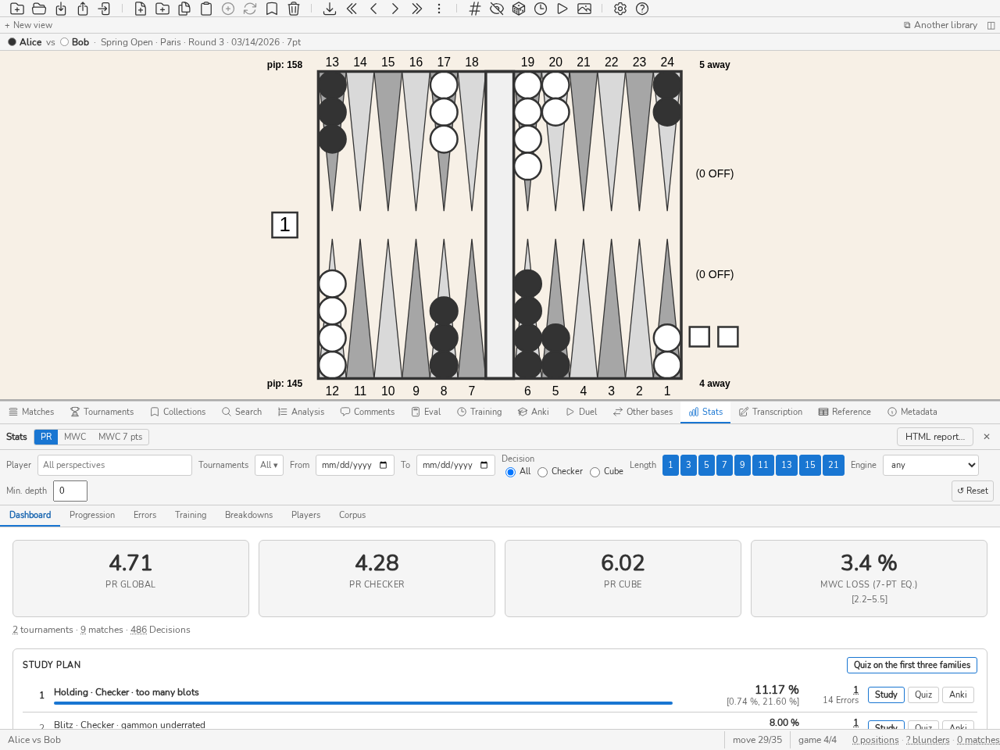
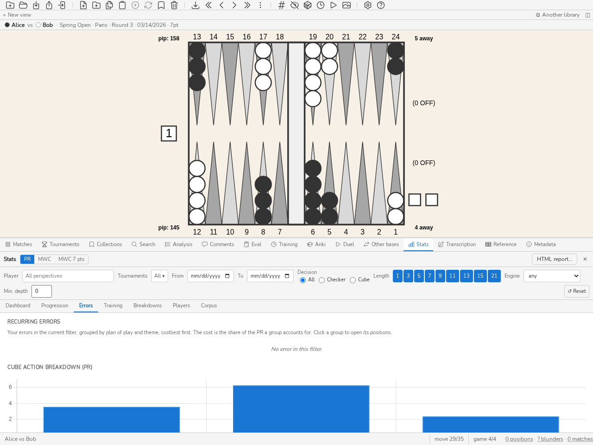

.. _manuel_stats:

Statistiques
============

.. _stats:

Panneau Stats
-------------

Introduction
~~~~~~~~~~~~~

Le panneau **Stats** permet d'analyser son niveau de jeu et de suivre sa
progression dans le temps à partir des positions importées dans la base de
données. Il calcule et affiche les indicateurs **PR** (*Performance Rating*) et
**MWC cost** (Match Winning Chance cost) pour l'ensemble des positions ou un
sous-ensemble filtré.

Le panneau Stats est particulièrement utile pour :

* **situer son niveau** par rapport aux bandes de niveau (*Classe mondiale*,
  *Expert*, *Avancé*…) grâce au PR global ;

* **suivre sa progression** tournoi après tournoi ou match après match grâce
  aux graphiques de l'onglet Progression ;

* **identifier ses points faibles** : onglet Erreurs pour voir la répartition
  entre coups joués et décisions de videau, et la distribution des magnitudes
  d'erreur ;

* **comparer les joueurs de la base** entre eux, une ligne par joueur, grâce à
  l'onglet Joueurs — utile pour suivre une compétition entière ;

* **accéder directement aux positions concernées** en cliquant sur n'importe
  quel indicateur (drill-down).

La définition, la formule, l'incertitude et les limites de chaque chiffre du
panneau sont réunies dans :ref:`metriques`.

Ouverture du panneau
~~~~~~~~~~~~~~~~~~~~~

Pour ouvrir le panneau Stats :

* Appuyer sur *CTRL-D*.
* Saisir la commande ``stats`` ou ``st`` dans la ligne de commande.

.. note::
   Le panneau se rafraîchit automatiquement à chaque modification du filtre.
   Il ne recalcule pas les statistiques lors d'un simple basculement PR ↔ MWC :
   les deux métriques sont calculées simultanément par le backend.

Barre de filtre
~~~~~~~~~~~~~~~

La barre de filtre, en haut du panneau, permet de restreindre le calcul à un
sous-ensemble de positions.

Perspective joueur
^^^^^^^^^^^^^^^^^^

Le champ **Joueur** filtre les statistiques selon le joueur analysé. Taper
quelques lettres réduit la liste aux noms qui les contiennent ; un clic ou
*Entrée* choisit le joueur, **✕** ou un champ vidé revient à toutes les
perspectives.

Le filtre est **un seul** pour tous les onglets du panneau et il est conservé
d'une session à l'autre. Il se règle aussi depuis les autres panneaux : le nom
d'un joueur dans l'en-tête d'un match ou dans la barre au-dessus du plateau
ouvre toutes ses statistiques (tournois et dates sont vidés), et le bouton
**Stats** de l'en-tête d'un tournoi ouvre celles de ce tournoi entier (dates
vidées, joueur conservé). Une date de fin antérieure à la date de début est
refusée : le champ reprend la date appliquée.

Filtres disponibles
^^^^^^^^^^^^^^^^^^^

* **Tournoi(s)** — restriction à un ou plusieurs tournois. Plusieurs tournois
  peuvent être sélectionnés simultanément.

* **Dates** — plage temporelle (*De* … *À*). Si seule la date de début est
  renseignée, les positions plus récentes sont incluses.

* **Type de décision** — Tous / Coups joués / Décisions de videau.

* **Longueur de match** — restriction à des longueurs de match précises (1, 3,
  5, 7, 9, 11, 13, 15, 21 points). Plusieurs longueurs peuvent être combinées.

* **Moteur** et **Profondeur min.** — ne garder que les décisions analysées par
  un moteur donné, ou au moins à une profondeur donnée, en plis. Le menu
  *Moteur* propose les moteurs présents dans les analyses de la base
  (eXtreme Gammon, GNU Backgammon…).

Un bouton **↺ Réinitialiser** remet tous les filtres à zéro, sauf le joueur.

.. note::
   Les filtres sont persistés dans la configuration de blunderDB
   (``config.yaml``) et sont restaurés à la prochaine ouverture.

Toggle PR / MWC
~~~~~~~~~~~~~~~

Le bouton **PR / MWC** en haut du panneau bascule la métrique affichée dans
tous les onglets.

**PR (Performance Rating)**

  L'erreur moyenne d'équité par décision comptée, multipliée par 500 comme
  le font eXtreme Gammon et GNUbg : un PR de 5,0 vaut 0,010 d'équité perdue
  par décision, soit 10 millipoints (mpt). La règle de comptage exacte —
  quelles décisions entrent au dénominateur, comment le score est converti —
  est celle de :ref:`metrique_pr`.

  Les bandes de niveau que le panneau dessine derrière la courbe de
  progression sont un **repère indicatif propre à blunderDB** : aucune
  publication ne fait autorité sur ces seuils. La borne haute de chaque
  bande est exclue : un PR de 4 est *Avancé*, pas *Expert*.

  .. csv-table::
     :header: "Niveau", "PR"
     :widths: 20, 10
     :align: center

     "Classe mondiale", "< 2"
     "Expert", "2 – 4"
     "Avancé", "4 – 6"
     "Intermédiaire", "6 – 9"
     "Occasionnel", "9 – 12"
     "Débutant", "≥ 12"

**MWC cost (Match Winning Chance cost)**

  Probabilité cumulée de victoire de match perdue à cause des erreurs, sur
  l'ensemble du jeu de données filtré. Calculé à partir de la MET courante de
  la base, par défaut la Kazaross-XG2 embarquée dans blunderDB. Une analyse au
  score de match calculée avec une autre table est « MET différente » et reste
  hors des statistiques.

  .. caution::
     Le MWC cost **n'est pas applicable** aux positions *money-game* (sans
     enjeu de match). Ces positions sont exclues du calcul MWC.
     Les valeurs MWC dépendent de la MET utilisée ; elles ne sont pas
     directement comparables entre logiciels utilisant des METs différentes.

.. _perte_mwc_7pts:

**Perte MWC (éq. 7 pts)**

  La probabilité de gagner le match qu'un joueur a perdue sur l'ensemble de ses
  décisions — pions, videau, prise ou refus, avec videau — ramenée à un match
  en 7 points. Pour un match en *N* points où le joueur a perdu *L* de MWC :

     L₇ = L × √(7 / N)

  Pour un match en 7 points, c'est la perte de MWC du match, celle
  qu'affiche eXtreme Gammon. La racine vient du modèle de la formule FIBS : à
  force égale, la perte d'un joueur croît comme la racine de la longueur du
  match. 7 points est la longueur de référence parce que c'est la plus
  courante en tournoi.

  Elle se lit comme la part de match perdue face à un joueur parfait : 12,3 %
  veut dire qu'au lieu de 50 % de chances contre le moteur, le joueur n'en
  avait plus que 37,7 % sur un match en 7 points. L'infobulle en donne la
  lecture en Elo face au moteur, en inversant la formule FIBS :
  D = (2000 / √7) × log₁₀(q / (1 − q)), avec
  q = 0,5 − L₇. Au-delà d'une perte de 49 %, la formule n'a plus
  de valeur finie : l'Elo affiché est alors un plafond (« ≤ »). Les deux
  chiffres classent les joueurs dans le même ordre.

  Elle complète le PR sans le remplacer : le PR divise les erreurs par un
  nombre de décisions, et ce nombre dépend de ce que l'on compte comme
  décision (coups forcés, décisions de videau évidentes). La perte MWC ne
  compte aucune décision : chaque erreur pèse ce qu'elle a coûté au score où
  elle a été commise.

  Sur plusieurs matchs (statistiques d'un joueur, d'un tournoi), les pertes et
  les racines des longueurs s'additionnent avant le rapport :
  L₇ = √7 × ΣL / Σ√N. Un match en 7 points
  pèse donc plus qu'un match en 1 point, et un seul match donne sa propre
  valeur.

  Un match isolé est très bruité : quelques grosses erreurs suffisent à le
  faire varier du simple au double. Le badge et le bilan d'un match
  (:ref:`bilan du match <bilan_match>`) donnent l'intervalle à 95 % en rééchantillonnant ses
  parties ; un agrégat (statistiques d'un joueur, d'un tournoi) le donne en
  rééchantillonnant ses matchs ; sans filtre joueur, les deux sièges d'un match
  forment une seule unité, puisqu'ils jouent les mêmes positions. Il faut au
  moins trois parties, ou trois matchs, et qu'elles ne donnent pas toutes la
  même perte : sinon pas d'intervalle. Une ligne par match des statistiques
  n'en a donc pas : c'est une seule unité. Ne classez pas des joueurs sur un
  seul match.

  .. caution::
     Une partie *money-game* n'a pas de longueur de match : la perte MWC
     (éq. 7 pts) n'y est pas définie et le panneau l'indique au lieu
     d'afficher un nombre. Comme le MWC cost, elle dépend de la MET.

  Le troisième choix du bouton, **MWC 7 pts**, trace cette perte dans l'onglet
  Progression, et l'affiche sur les cartes du tableau de bord et dans la
  comparaison pions/videau de l'onglet Erreurs, découpée en pions et videau
  sur les mêmes matchs (les deux parts s'additionnent). Le classement des
  joueurs a sa colonne. Les graphiques sans équivalent 7 points (par action de
  videau) gardent le MWC cost.

Le basculement PR ↔ MWC est instantané : aucun recalcul backend n'est
effectué.

.. _rapport_html:

Le rapport HTML
~~~~~~~~~~~~~~~

Le bouton **Rapport HTML** de l'en-tête du panneau produit un document
**autonome** : un seul fichier, sans image externe, sans feuille de style
distante, sans script. Les diagrammes y sont des SVG en ligne, dessinés par le
même rendu que le plateau à l'écran, avec votre palette. Il s'ouvre dans
n'importe quel navigateur, s'envoie par courriel, et **s'imprime en PDF par le
navigateur lui-même** — ce qui évite d'embarquer un générateur de PDF pour
produire ce que tout le monde a déjà.

Il contient les indicateurs du périmètre courant (positions, matchs, décisions
comptées, PR global, pions et videau), puis les **dix décisions les plus
coûteuses**, chacune avec son diagramme, son coût, le match d'où elle vient et
le meilleur coup lorsqu'une analyse le donne.

Le document est construit par le moteur, pas par l'écran : la ligne de commande
(``stats report --html``, voir :ref:`cli_stats`) et le démon HTTP (route
``stats.report``) produisent le même rapport, dans l'une des neuf langues de
l'interface. Seule l'application graphique dessine les diagrammes avec la
palette du plateau ; les deux autres emploient la palette par défaut.

Le rapport porte le **filtre courant** du panneau Stats. Un rapport qui ne dit
pas son périmètre est un rapport dont les chiffres ne veulent rien dire :
réglez le filtre — un tournoi, une plage de dates, un joueur — avant de le
produire.

Onglet Tableau de bord
~~~~~~~~~~~~~~~~~~~~~~

L'onglet **Tableau de bord** donne une vue synthétique des indicateurs clés.
Il se lit de haut en bas : les cartes de niveau, puis ce qui se travaille (plan
d'étude, top blunders), puis les lectures (PR glissant, avant/après l'étude,
biais signés). L'explication de chaque carte est dans l'info-bulle de son
titre.

   L'onglet Tableau de bord : PR global, PR pions, PR videau.

Cartes de niveau
^^^^^^^^^^^^^^^^

Trois cartes affichent le PR (ou MWC) pour :

* **PR global** — toutes les décisions (pions + videau) ;
* **PR pions** — décisions de pions seulement ;
* **PR videau** — décisions de videau seulement.

Cliquer sur une carte charge dans le panneau d'analyse les positions du
sous-ensemble correspondant (drill-down). Une quatrième carte, **Perte MWC (éq.
7 pts)**, donne cette perte quel que soit le choix du bouton PR / MWC, avec son
intervalle ; elle ne charge rien.

Sous les cartes, la ligne des totaux compte les tournois, les matchs et les
décisions du filtre. Le nombre de tournois ouvre ces tournois dans le panneau
Tournois : un tournoi seul s'ouvre directement ; plusieurs restreignent la
liste, qui porte alors le bouton « N tournois ouverts depuis les Stats × » : il
rend la liste complète.

Le nombre de décisions ouvre leurs positions ; le nombre
de matchs ouvre ces matchs dans le panneau Matchs, sauf quand un type de
décision ou un filtre de provenance est actif : il compte alors moins de
matchs que la liste n'en ouvrirait et reste un simple nombre.

.. note::
   Le nombre total de décisions est affiché en bas de chaque carte au survol.

.. _plan_etude:

Plan d'étude
^^^^^^^^^^^^

La carte **Plan d'étude** répond à « que dois-je travailler maintenant ? ».
Les erreurs récurrentes (onglet Erreurs) disent où le filtre a perdu le plus ;
elles ne disent pas où l'étude rapporte le plus. Une famille de positions
réellement difficiles coûte cher à tout le monde, et trois erreurs ne font pas
une tendance. Le plan corrige les deux.

* Une **famille** est un groupe des erreurs récurrentes : un plan de jeu, une
  nature de décision (pions ou videau) et un thème. Les erreurs sans thème
  n'en forment pas : elles n'indiquent rien à étudier.
* Chaque erreur est chiffrée en **MWC**, comme dans le panneau Match : sa
  perte ℓ, et sa *difficulté* d, la perte qu'un joueur de référence aurait
  subie dans la même position (voir la difficulté par décision du panneau
  Match). Une erreur en partie libre n'a pas de MWC : elle est seulement
  comptée, « non chiffrée ».
* Le **MWC récupérable** d'une famille est la somme de ℓ − d sur ses erreurs :
  la fréquence de la famille multipliée par sa perte moyenne au-delà de la
  difficulté. C'est ce que vous regagneriez en jouant ces positions comme le
  joueur de référence. Une famille d'erreurs évitables monte, une famille de
  positions où tout le monde se trompe descend.
* L'**intervalle à 95 %** accompagne chaque chiffre. Une famille entre au plan
  à partir de **5 erreurs** et d'un intervalle entièrement au-dessus de zéro ;
  le plan est classé par la borne basse de l'intervalle, si bien qu'à
  récupérable égal la famille la mieux établie passe devant. Les autres sont
  nommées sous la liste, **à confirmer**, sans rang : le plan ne vous pousse
  pas vers du bruit. La même ligne compte les erreurs **hors plan** (sans
  thème, non chiffrées).

Chaque ligne du plan montre son rang, la famille, une barre dont la longueur
est son MWC récupérable rapporté à celui de la première, ce MWC avec son
intervalle, et le nombre d'erreurs. Chaque compte de positions du plan (par
famille, à confirmer, hors plan) est cliquable : il charge exactement ces
positions dans la liste.

Chaque famille propose trois gestes : **Étudier** ouvre la file d'étude sur
ses positions, l'écart au joueur de référence le plus grand d'abord ; **Quiz**
lance l'exercice Décision du panneau :ref:`Entraînement <panneau_entrainement>`
sur vingt d'entre elles ; **Anki** en fait un paquet de cartes. En tête de la
carte, **Quiz sur les trois premières familles** tire vingt positions parmi
celles des trois familles de tête. Le plan suit le filtre du panneau : réglez
le joueur pour obtenir *votre* plan. En ligne de commande :
``blunderdb stats plan`` (voir :ref:`cli_stats`).

.. _avant_apres_etude:

Avant/après l'étude
^^^^^^^^^^^^^^^^^^^

La carte **Avant/après l'étude** ferme la boucle du plan : ce que vous avez
travaillé coûte-t-il moins en match réel ? Sans elle, l'étude se juge à
l'impression ; avec elle, une famille qui ne bouge pas malgré le travail dit
qu'il faut changer de méthode, et une famille en progrès peut céder sa place
dans le plan.

* Une famille (celle du plan) est **étudiée** à la date de la première action
  d'étude sur l'une de ses positions : la marque « étudiée » de la file
  d'étude, une révision Anki, une réponse en quiz. Créer une carte ou ranger
  une position en collection n'en est pas une.
* Pour chaque famille étudiée, la carte compare deux **fenêtres** : les matchs
  joués avant ce jour et ceux joués après (le jour même est écarté). Dans
  chacune, le **taux de perte** est la MWC perdue par les erreurs de la
  famille, rapportée à toutes les décisions du même plan de jeu et de la même
  nature, et affichée en points de MWC pour 100 décisions.
* Le **gain** est le taux d'avant moins celui d'après, avec son intervalle à
  95 %. Le verdict n'est « en progrès » (ou « en recul ») que si chaque
  fenêtre compte au moins **30 décisions** et que l'intervalle exclut zéro ;
  sinon il reste « indéterminé » ou « trop peu de décisions ».

À côté de chaque fenêtre, la colonne **Positions** compte les positions
distinctes de ses décisions et les ouvre d'un clic ; le nombre entre
parenthèses reste celui des décisions, dénominateur du taux.

C'est un changement, pas un effet : une famille est étudiée parce qu'elle
coûtait, et une part du gain est une régression vers la moyenne ; rien ne
contrôle les adversaires, le format ni les dés. En ligne de commande :
``blunderdb stats effect`` (voir :ref:`cli_stats`).

.. _biais_signes:

Biais signés
^^^^^^^^^^^^

La carte **Biais signés** dit dans quel sens vous vous trompez, pas seulement
combien. « Vous prenez trop » se corrige mieux qu'un PR : la règle à revoir
est nommée. Chaque biais est la part de décisions fautives dans un sens moins
la part fautive dans l'autre, avec son intervalle à 95 % ; un penchant n'est
nommé qu'à partir de **20 décisions** et d'un intervalle qui exclut zéro.

* **Prise / refus** — sur les réponses au videau : prises fautives (le bot
  refuse) moins refus fautifs (le bot prend). C'est exactement votre taux de
  prise moins celui du bot sur les mêmes positions.
* **Doubles** — sur les décisions de doubler : doubles prématurés (le bot ne
  double pas, ou la position est trop bonne pour doubler) moins doubles
  manqués. Le même biais est donné **par score** (votre away, celui de
  l'adversaire, un score post-Crawford compté à 1 point ; la partie libre
  dans sa propre case), pour les scores qui comptent assez de décisions.
* **Blots** — sur les coups de pions avec contact : les coups qui laissent plus
  de blots que le meilleur coup moins ceux qui en laissent moins. Un coup est
  reconnu par le plateau qu'il laisse, quelle que soit son écriture
  (« 13/7(2) », « 8/5*/4 ») ; un coup que le générateur de coups ne sait
  toujours pas rejouer est écarté, et la part des coups écartés est donnée
  sous le tableau. Le biais compte les blots sans peser leur exposition : un
  blot hors de portée compte autant qu'un blot exposé.

À côté de chaque compte, son coût en millipoints dit si le penchant coûte ;
une position jouée dans plusieurs matchs y compte avec le coup joué dans
chacun. Les biais suivent le filtre du panneau. En ligne de commande :
``blunderdb stats biases`` (voir :ref:`cli_stats`).

Chaque compte de décisions (toutes, d'un sens, de l'autre) est suivi d'une
colonne **Positions** : les positions distinctes de ces décisions, qu'un clic
ouvre. Une position jouée dans plusieurs matchs y compte une décision par
match, mais une seule position.

PR glissant sur N dernières décisions
^^^^^^^^^^^^^^^^^^^^^^^^^^^^^^^^^^^^^^

Une ligne de valeurs PR (ou MWC) calculées sur les *N* dernières décisions
(N = 5, 10, 50, 100, 250, 500, 1000) permet de mesurer la tendance récente.
Les valeurs grisées correspondent à un N supérieur au nombre de décisions
disponibles.

Cliquer sur une valeur charge les *N* dernières positions correspondantes.

Top blunders
^^^^^^^^^^^^

La liste des 10 pires erreurs (ou MWC cost), triées par magnitude décroissante.
Cliquer sur une ligne charge la position concernée dans le panneau d'analyse.

Onglet Progression
~~~~~~~~~~~~~~~~~~

L'onglet **Progression** présente l'évolution du niveau dans le temps.

En tête de l'onglet, un **objectif** : « PR < 5 d'ici douze semaines ». Une
cible, une échéance, et une tendance qui dit où l'on va — rien de plus. Un
objectif qui se mettrait à noter, à féliciter ou à rappeler serait une autre
fonctionnalité, et pas celle-ci.

Le bouton **Proposer** suggère une cible à partir du niveau actuel : la borne
basse de la bande où vous êtes, c'est-à-dire l'entrée dans la bande suivante.
Proposer « un peu mieux » ne s'ancrerait à rien ; proposer un palier en dit
un — passer d'intermédiaire à avancé se voit et se raconte.

La **tendance** est un ajustement par les moindres carrés sur le PR de vos
matchs, projeté à l'échéance. Elle refuse de se prononcer sous trois matchs :
tracer une droite entre deux points serait une affirmation qu'on ne peut pas
tenir. Et la phrase le dit à chaque fois — *une tendance n'est pas une
prédiction*.

L'objectif est enregistré dans les **métadonnées de la base**, pas dans la
configuration : il porte sur cette bibliothèque-là, et suit donc le fichier
plutôt que la machine. Aucun changement de schéma : ``metadata`` est déjà une
table de clés et de valeurs, lisible par ``blunderdb info`` comme par le démon.

Courbe par tournoi
^^^^^^^^^^^^^^^^^^

Un graphique en ligne affiche le PR (ou MWC) de chaque tournoi : un point par
tournoi, étiqueté de son nom, dans l'ordre chronologique de sa date — à défaut,
celle de son plus ancien match (axe Y : valeur de la métrique). Des bandes de
couleur matérialisent les seuils de niveau.

Cliquer sur un point du graphique ouvre un menu contextuel avec deux options :

* **Ouvrir le tournoi** — ouvre le tournoi dans le panneau Tournois.
* **Ouvrir les positions** — charge toutes les positions du tournoi dans le
  panneau d'analyse.

Scatter plot par match
^^^^^^^^^^^^^^^^^^^^^^

Un nuage de points représente chaque match (axe X : date, axe Y : PR ou MWC).
La taille du point est proportionnelle au nombre de décisions dans le match.
Un match sans date n'y figure pas.

Cliquer sur un point ouvre un menu contextuel :

* **Ouvrir le match** — ouvre le match dans le panneau des matchs.
* **Ouvrir les positions** — charge toutes les positions du match dans le
  panneau d'analyse.

Onglet Erreurs
~~~~~~~~~~~~~~

L'onglet **Erreurs** décompose les sources d'erreurs.

   L'onglet Erreurs : répartition du PR par action de videau.

Erreurs récurrentes
^^^^^^^^^^^^^^^^^^^

En tête de l'onglet, un tableau regroupe les erreurs du filtre courant — donc
celles d'un seul joueur quand un joueur est filtré — par **plan de jeu** et par
**thème**, la plus coûteuse d'abord. Il répond à la question « où est-ce que je
perds le plus ? » : par exemple, « tenue · trop de blots ».

* Une **erreur** est une décision comptée dont le coût atteint le seuil
  *Erreur* de la bibliothèque.
* Le **plan de jeu** est celui du joueur au trait, tel que l'onglet
  Ventilations le présente.
* Le **thème** d'un coup de pions est celui que nomment les règles de la
  phrase d'explication du :ref:`panneau Analyse <panneau_analyse>` : gammon
  sous-estimé, trop de blots, point non fait, trop passif. Celui d'une
  décision de videau est le sens de l'erreur, comme dans la direction des
  erreurs de videau ci-dessous : double manqué, double prématuré, passe à
  tort, prise à tort.
* Une erreur qu'aucune règle ne nomme avec assurance n'est pas devinée : elle
  sort du classement et apparaît à part, sous le tableau, en une ligne par
  plan de jeu (« sans thème identifié : N erreurs, coût X »), cliquable elle
  aussi. Ce reste est souvent le plus lourd, car l'explication ne se prononce
  qu'à partir de 60 mp, au-dessus du seuil *Erreur* : classé avec les autres,
  il coifferait un tableau qui ne dirait rien.
* Le **coût** est la part du PR du filtre que le groupe représente : la
  formule du PR appliquée aux erreurs du groupe, rapportée à toutes les
  décisions comptées. Les coûts des groupes ne dépassent donc jamais le PR.

Cliquer sur un groupe, ou sur son nombre d'erreurs, charge ses positions, de
la plus coûteuse à la moins coûteuse. Le thème est recalculé à chaque affichage, jamais enregistré :
comme le plan de jeu, c'est une étiquette dérivée, non modifiable. En ligne de
commande : ``blunderdb stats recurring`` (voir :ref:`cli_stats`).

Chaque ligne propose trois gestes pour passer de l'erreur à l'étude :
**Quiz sur ce groupe** lance l'exercice Décision du panneau
:ref:`Entraînement <panneau_entrainement>` sur les positions du groupe,
**Paquet Anki** en fait un paquet de cartes, **Collection** les range dans une
nouvelle collection. Au-dessus du tableau, **Quiz de mes trois pires groupes**
tire vingt positions au hasard parmi celles des trois groupes les plus
coûteux. En ligne de commande, ``stats recurring --quiz`` tire ces
positions et ``--deck`` crée le paquet.

Répartition par action de videau
^^^^^^^^^^^^^^^^^^^^^^^^^^^^^^^^^

Un diagramme en barres affiche le PR (ou MWC) pour chaque type de décision
de videau : *NoDouble*, *DoubleTake*, *DoublePass*, *TooGood*. Chaque barre
indique également le nombre de décisions et le taux de blunders en infobulle.

Cliquer sur une barre charge les positions correspondant à cette action de
videau, **uniquement celles avec une erreur** (drill-down).

Direction des erreurs de videau
^^^^^^^^^^^^^^^^^^^^^^^^^^^^^^^

La répartition ci-dessus indique *combien* coûtent les décisions de videau ;
ce tableau indique dans *quel sens* elles se trompent.

Une position de videau porte deux décisions prises par deux joueurs
différents, présentées ici en deux lignes :

* **Offrir** — le joueur qui tient le videau double ou ne double pas. Ses
  erreurs sont les **doubles manqués** (il fallait doubler) et les **doubles
  prématurés** (il ne fallait pas).

* **Répondre** — le joueur à qui le videau est offert prend ou passe. Ses
  erreurs sont les **passes à tort** (une prise correcte a été passée) et les
  **prises à tort** (une passe correcte a été prise).

Les deux lignes restent séparées à dessein : un joueur peut parfaitement
doubler tard *et* prendre large, et un indicateur unique appellerait cela
« équilibré » en perdant les deux moitiés de l'information.

Chaque case affiche le nombre de décisions ; l'infobulle donne l'équité perdue
cumulée. Cliquer sur une case charge les positions correspondantes. Une case à
zéro n'est pas cliquable.

.. note::
   Ce tableau compte des décisions, il ne porte pas de jugement. À partir de
   quel écart une tendance mérite d'être nommée dépend de l'effectif et d'un
   point de référence, qui ne sont pas des données du moteur.

Répartition Checker / Cube
^^^^^^^^^^^^^^^^^^^^^^^^^^^

Un diagramme comparatif place côte à côte le PR des coups joués et des
décisions de videau. Cliquer sur une barre charge les positions du
sous-ensemble avec erreur.

Histogramme des magnitudes d'erreur
^^^^^^^^^^^^^^^^^^^^^^^^^^^^^^^^^^^^

Un histogramme distribue les erreurs selon leur magnitude en millipoints
(mpt, tranches : 0–5, 5–10, 10–25, 25–50, 50–100, ≥ 100). Cliquer sur
une barre charge les positions de la tranche.

.. _stats_entrainement:

Entraînement dans le temps
~~~~~~~~~~~~~~~~~~~~~~~~~~

L'onglet **Entraînement** met côte à côte, sur les mêmes fenêtres
calendaires — la **semaine** ou le **mois**, au choix — trois séries qui
mesurent la progression par trois chemins :

* le **PR du quiz** : celui des sessions de l'exercice Décision du panneau
  Entraînement, pondéré par le nombre de décisions jugées. Il est calculé sur
  l'échelle du PR réel, donc comparable à lui ;
* le **PR des matchs** du filtre courant, pondéré par le nombre de décisions ;
* la **rétention Anki** : la part des révisions de cartes déjà apprises
  notées *Difficile* ou mieux, lue sur l'axe de droite (en %).

Sous le graphique, le **PR du quiz par plan de jeu** range les décisions du
quiz tirées de positions de la bibliothèque, les pires plans d'abord, avec le
PR de la dernière fenêtre où le plan a été joué.

Entre parenthèses, le nombre de décisions ou de révisions derrière chaque
valeur : une fenêtre sans échantillon n'a pas de valeur — un tiret, pas un
zéro. Le nombre de décisions de matchs d'une fenêtre ouvre leurs positions. Le filtre ne restreint que les matchs ; le journal du quiz et celui
d'Anki sont les vôtres et ne portent pas de joueur. Rien n'est enregistré en
plus : les trois séries sont relues dans les journaux existants. En ligne de
commande : ``blunderdb stats training`` (voir :ref:`cli_stats`).

Onglet Ventilations
~~~~~~~~~~~~~~~~~~~

L'onglet **Ventilations** découpe les mêmes décisions que les chiffres globaux
selon quatre axes. Aucun d'eux ne redéfinit ce qui compte comme une décision :
ce serait un second PR sous le même nom.

* **Par phase de partie** — ouverture, milieu de partie, course, sortie des
  pions. C'est ce qui répond à « mon PR en course contre mon PR en contact ».
  L'étiquette est calculée depuis le plateau (voir :ref:`panneau_recherche`) ;
  une base dont les phases n'ont jamais été calculées range tout sous *Non
  classée*, et ``blunderdb repair`` la remplit.

* **Par plan de jeu** — course, blitz, tenue, backgame, amorce contre
  amorce… C'est la ventilation pour laquelle le classificateur existe : « où
  est-ce que je perds le plus ? », plan par plan. Même étiquette dérivée que
  la phase, mêmes réserves, et ``blunderdb repair`` la remplit de la même
  façon.

* **Par étiquette** — les ``#mot`` écrits dans les commentaires. Une position
  peut en porter plusieurs : **ces lignes ne s'additionnent pas au total**, et
  le panneau le dit sous le tableau. Une étiquette qualifie, elle ne partitionne
  pas.

* **Par score** — l'écart au but des deux camps, lu du côté du joueur au trait,
  donc du côté de celui qui décide. La ligne *Money* est la partie d'argent.
  Une cellule sans intervalle est **grisée avec son effectif visible**
  plutôt que cachée (voir ci-dessous).

Les colonnes **Positions** et **Bourdes** comptent des positions distinctes, et
chaque chiffre est un lien : un clic charge exactement ces positions dans le
panneau d'analyse, comme les compteurs de la barre d'état. *Bourdes* compte les
positions où au moins une décision est une bourde. Une position jouée dans
plusieurs matchs (une ouverture, par exemple) n'y compte qu'une fois ; la
colonne **Décisions** la compte à chaque fois, car c'est le dénominateur du PR.

Chaque ligne porte son **intervalle de confiance à 95 %** (colonne *IC 95 %*),
qui remplace le seuil fixe de dix décisions : il dit ce que vaut un PR, pas
seulement combien de décisions le portent. Il rééchantillonne les **matchs** de
la sélection, pas les décisions ni les parties : les parties d'un match
partagent adversaire, séance et fatigue, et les compter comme indépendantes
donnerait un intervalle trop étroit ; sans filtre joueur, les deux sièges d'un
match forment une seule unité. Une ligne qui repose sur moins de trois matchs,
ou dont tous les matchs donnent le même PR, n'a pas d'intervalle et est grisée,
même avec beaucoup de décisions : deux matchs ne disent rien de la dispersion,
et des matchs identiques disent qu'ils s'accordent, pas que le PR est exact. Pour l'étude : une
famille de positions dont l'intervalle reste au-dessus de votre PR global est
une faiblesse établie ; une ligne à l'intervalle large ne justifie pas encore un
plan de travail. Le PR global du tableau de bord porte le même intervalle, sous
sa carte.

.. note:: Dans la ventilation par score, un score post-Crawford est lu comme
   1-away : la partie Crawford et les parties post-Crawford au même score
   tombent dans la même cellule.

Étude et jeu réel
~~~~~~~~~~~~~~~~~

La commande ``blunderdb list --type study --days 30`` met côte à côte, plan de
jeu par plan de jeu, trois nombres : combien de **positions distinctes** ont
été révisées sur la période, quel était le PR **avant** elle, quel est le PR
**depuis**.

Trois nombres, et pas un quatrième. Il n'y a **ni colonne de gain ni flèche**,
parce que rien ici ne contrôle quoi que ce soit : le joueur a pu rencontrer
des adversaires plus forts, changer de format, ou simplement jouer plus de
courses ce mois-ci. Le rapprochement est celui du lecteur ; une colonne qui
annoncerait un effet affirmerait une causalité que ces données ne portent pas.
Les nombres, eux, sont exacts.

Les révisions sont comptées en **positions distinctes** : une carte revue
quatre fois dans le mois est une position étudiée, et compter les répétitions
ferait passer un mois de bachotage pour un mois de couverture. Les décisions
du PR, elles, sont toutes comptées — chacune a été prise une fois. Un PR
appuyé sur moins de dix décisions s'affiche ``—``, avec son effectif visible à
côté.

Onglet Joueurs
~~~~~~~~~~~~~~

Les cinq onglets précédents décrivent **un** joueur ; l'onglet **Joueurs** les
compare tous. Il affiche une ligne par joueur de la base, ce qui répond au
besoin d'un organisateur suivant une compétition entière plutôt qu'un joueur en
particulier.

   L'onglet Joueurs : une ligne par joueur, triable par n'importe quelle
   colonne.

Colonnes, dans l'ordre :

.. csv-table::
   :header: "Colonne", "Signification"
   :widths: 22, 78

   "Joueur", "Le nom **tel qu'il figure dans les matchs**. Un joueur enregistré sous deux orthographes apparaît sur deux lignes, sauf si l'une est un alias de l'autre (section Corpus des paramètres) : la ligne porte alors le nom canonique."
   "Matchs", "Nombre de matchs disputés dans la période retenue."
   "V–D", "Victoires et défaites. Un match inachevé (journal tronqué, abandon) ne compte ni l'une ni l'autre : V + D peut donc être inférieur au nombre de matchs."
   "Décisions", "Nombre de décisions comptées — le dénominateur du PR. C'est la colonne qui dit ce que valent les taux voisins : un PR calculé sur douze décisions ne signifie rien."
   "PR", "Performance Rating global."
   "PR pions, PR videau", "Le PR ventilé par type de décision."
   "Snowie", "Snowie Error Rate (voir :ref:`stats_parity`)."
   "Blunders", "Nombre d'erreurs atteignant le seuil de blunder de la bibliothèque (0,100 EMG par défaut). Cliquer sur ce nombre charge ces positions dans le panneau d'analyse."
   "Chance", "Chance moyenne par lancer, en millipoints (mpt), signée : positive si les dés ont été favorables."

Utilisation :

* **Trier** — cliquez sur un en-tête de colonne. Le tableau s'ouvre trié par PR
  croissant, meilleur joueur en tête, et retient d'une session à l'autre le
  dernier tri choisi. Les joueurs dont rien n'a été mesuré
  restent en bas quel que soit le sens du tri : un zéro faute de données n'est
  pas une performance parfaite.
* **Filtrer par colonne** — la ligne de champs sous les en-têtes filtre chaque
  colonne : un morceau de nom pour le texte, une borne pour les nombres
  (``>=500``, ``>500``, ``<2.5``, ``<=2``), un intervalle (``3-7``) ou une
  valeur exacte (``5``). Un champ illisible est encadré de rouge et ne filtre
  rien ; une valeur jamais mesurée ne passe aucune borne. Les filtres de colonne
  durent le temps de la session. Le **classement** des joueurs se lit ainsi :
  tri par PR, colonne *Décisions* filtrée par ``>=500``. Tous les tableaux du
  panneau Stats — ventilations, corpus, erreurs récurrentes, temps de
  réflexion, entraînement, biais, effet de l'étude — se trient et se filtrent
  de la même façon.
* **Ouvrir le détail d'un joueur** — cliquez sur une ligne. Le joueur est
  sélectionné dans la barre de filtres et l'affichage bascule sur l'onglet
  Tableau de bord.
* **Ouvrir ses décisions** — le nombre de décisions ouvre leurs positions, sous
  les filtres du tableau. Le nombre de matchs et le bilan V–D restent de simples
  nombres : ils comptent aussi les matchs sans décision analysée, qu'aucune
  liste de matchs ne reproduit.
* **Restreindre la période** — les filtres de dates, de tournois et de longueur
  de match s'appliquent normalement, ce qui permet de borner le tableau aux
  dates d'une compétition.
* **Comparer deux joueurs** — cochez la case de la première colonne sur deux
  lignes. Un bloc apparaît au-dessus du tableau et met leurs indicateurs face à
  face ; cocher un troisième joueur remplace le plus ancien des deux. La case ne
  sélectionne pas la ligne : cocher compare, cliquer ouvre le détail.
* **Voir les positions où l'un a mieux joué** — le bouton du bloc de comparaison
  liste les positions que les deux joueurs ont eu à jouer et où l'un a bien joué
  (en dessous du seuil Erreur de la bibliothèque) et l'autre non, l'écart le plus
  large d'abord ; le joueur est jugé sur son pire coup de la position. *Ouvrir
  ces positions* les charge dans la vue analyse. La ligne de commande et le
  serveur donnent la même liste (``stats contrast``).
* **Noter les coups d'abord** — la liste ne compare que les coups dont l'erreur
  est notée, et aucun import ne les note : la notation se fait sur demande. Tant
  qu'il en reste à noter, le bloc en donne le nombre avec un bouton *Noter les
  coups* ; la ligne de commande fait la même chose avec ``repair --move-errors``.

Dans ce bloc, **seuls les taux reçoivent un verdict**, et le meilleur des deux
est mis en gras. Trois indicateurs n'en reçoivent jamais, et il vaut de dire
pourquoi. La **chance** n'est pas une qualité : un joueur plus chanceux n'est
pas meilleur. Les **matchs, le bilan et les décisions** situent ce que les taux
valent, mais les mettre en compétition ferait gagner celui qui a simplement
joué davantage. Le **nombre de blunders** ne se compare pas brut — douze sur
mille décisions valent mieux que dix sur cent —, aussi le bloc ajoute-t-il une
ligne *Blunders / 100 déc.* qui, elle, se compare, et laisse le compte à côté
comme contexte.

Une égalité n'est pas une victoire : elle n'est mise en gras d'aucun côté. Un
taux qui n'a rien derrière lui s'affiche « — » et ne départage rien.

.. note::
   Dans cet onglet, le choix du **type de décision** est désactivé : le tableau
   ventile déjà les décisions de pions et de videau en colonnes distinctes. Le
   joueur de la barre de filtres reste actif : le tableau montre toujours tous
   les joueurs, et la ligne de celui-ci est mise en évidence et amenée à
   l'écran.

Deux vues de
corpus figurent dans l'onglet **Corpus** du panneau, en ligne de
commande et par l'API du démon (voir :ref:`cli_stats`) : le **face-à-face** de deux joueurs (matchs communs, PR de
chacun, bilan) et le **PR par fenêtre calendaire** glissante (1, 3, 6 ou 12 mois).
L'onglet Corpus calcule chaque vue à la demande, sous le
filtre courant. Le **classement** par PR se lit dans l'onglet Joueurs, trié par PR
et filtré sur la colonne *Décisions* ; la ligne de commande et l'API le donnent
aussi (``stats ranking``). Un **filtre de provenance** (champs *Moteur* et *Profondeur
min.* de la barre de filtres) restreint les statistiques aux décisions analysées ainsi ; il porte
sur chaque décision, et les chiffres qu'il touche sont alors recalculés depuis
les décisions. Le face-à-face et le PR par fenêtre ne l'acceptent pas : tant
qu'il est actif, ils refusent de se calculer. Comme le reste de la barre, il
est conservé d'une session à l'autre.

Dans l'onglet Corpus, chaque ligne ouvre ce qu'elle résume. Le bilan du
face-à-face ouvre ses matchs dans le panneau Matchs, qui porte alors le bouton
« N matchs ouverts depuis les Stats × » : il rend la liste complète ; une ligne
de face-à-face ouvre son match. Le premier joueur du face-à-face est d'emblée
celui de la barre de filtres. Une ligne de fenêtre et son nombre de décisions
ouvrent ses positions, son nombre de matchs ouvre les matchs. Un compte de positions du panneau Stats, quel que soit
l'onglet, quitte d'abord le match en cours avant d'ouvrir sa liste ; la commande
``m`` rouvre ensuite le match au coup sauvegardé.

.. important::
   Un tiret (« — ») signale une valeur **jamais mesurée**, à ne pas confondre
   avec zéro. C'est notamment le cas de la colonne Chance pour tout match
   importé avant la version 2.15.0 du schéma : la chance n'était alors pas
   conservée, et rien ne permet de la reconstituer après coup. Réimporter le
   fichier source ne suffit pas : l'import y reconnaît un doublon et n'applique
   que les marques d'étude nouvellement levées (le rapport en donne le nombre).
   Il faut supprimer le match, puis le réimporter. Les formats
   qui ne la transportent pas (BGF, Jellyfish ``.mat``) n'en fourniront jamais.

Règle d'agrégation
~~~~~~~~~~~~~~~~~~

.. important::
   Le PR d'un tournoi (ou d'un sous-ensemble quelconque) est calculé par
   la règle **somme/somme** — jamais comme moyenne des PR individuels des
   matchs.

   Formule :

   .. math::

      PR_{tournoi} = 500 \times \frac{\sum_{i} \text{erreur}_i}{\text{nombre total de décisions}}

   **Exemple :** un joueur dispute deux matchs dans un tournoi —

   * Match A : 10 décisions, 0,100 d'équité perdue → PR = 5,0
   * Match B : 90 décisions, 0,540 d'équité perdue → PR = 3,0

   Moyenne naïve des PR : (5,0 + 3,0) / 2 = **4,0** *(incorrect)*

   Règle somme/somme : 500 × 0,640 / (10 + 90) = **3,2** *(correct)*

   La règle somme/somme est la seule qui résiste à la variation de longueur
   des matchs (un match en 21 points pèse plus qu'un match en 1 point).

MWC : limitations
~~~~~~~~~~~~~~~~~

* Par défaut, le MWC cost est calculé à partir de la **MET Kazaross-XG2**, table de
  référence de facto dans le backgammon compétitif. Les résultats ne sont
  pas directement comparables avec des logiciels utilisant d'autres METs.
  C'est la même table, lue par le même point d'entrée, que celle dont
  l'évaluateur embarqué se sert pour ses décisions de videau au score : les
  statistiques et le moteur ne peuvent pas diverger là-dessus. Elle donne ses
  valeurs propres jusqu'à 25 points à faire de chaque côté ; au-delà, elle est
  prolongée par une table de Zadeh calculée comme celle de GNUbg, jusqu'à 64.

* Les positions *money-game* (sans score de match) sont **exclues** du
  calcul MWC. Si votre base de données contient beaucoup de positions
  money-game, le MWC cost peut être sous-estimé ou indisponible.

* Le MWC cost est cumulatif sur l'ensemble du jeu de données filtré — pas
  un indicateur par décision. Il mesure l'impact total de vos erreurs sur
  vos chances de victoire.

