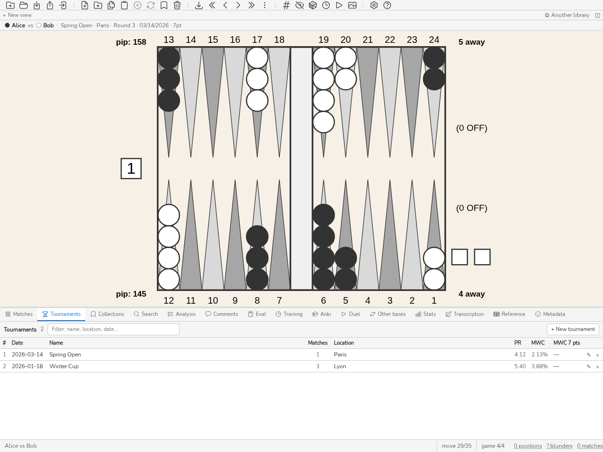

.. _manuel_tournois:

Tournois
========

.. _panneau_tournois:

Panneau Tournois
----------------

   Le panneau Tournois : un tournoi par ligne, nombre de matchs, PR du
   joueur de référence.

Le panneau **Tournois** (*CTRL-Y*) permet de regrouper des matchs en tournois
pour un suivi organisé et une analyse statistique par événement. Les tournois
peuvent être créés, renommés et supprimés ; les matchs peuvent leur être
assignés. Les statistiques du panneau Stats peuvent être filtrées par tournoi.
Appuyer sur *CTRL-Y* pour afficher ou masquer le panneau.

**Nouveau tournoi** ouvre le champ de création, qui prend le focus ; *ÉCHAP* ou
**Annuler** le referme. Le champ de filtre, dans la bande d'en-tête, restreint
la liste à la frappe : tous les mots saisis doivent se retrouver dans le nom, le
lieu ou la date, le compteur indique « affichés / total » et *ÉCHAP* efface le
champ. Un clic surligne une ligne, un double-clic ou *ENTRÉE* ouvre le tournoi. Son en-tête porte la date, le lieu et le nombre de matchs, qu'un
clic change en liste des positions du tournoi ; à droite, les notes, **Diriger**
et **Bilan**. Dessous, ses matchs, un par ligne, que ▲ et ▼ réordonnent, que ⇄ échange de joueurs et que × retire du
tournoi. Un clic sur un match affiche sous la table sa fiche, la même que dans le
panneau Matchs (onglets Transcription, Graphes, À revoir, Détails, Infos, Stats) ;
un second clic ou *ÉCHAP* la referme, un double-clic ou *ENTRÉE* ouvre le match dans le plateau. Le champ **Ajouter un match…** y range un match de la base, et ←
ramène à la liste des tournois.

Chaque ligne commence par son rang (#) et sa date, comme dans le panneau
Matchs : la liste va du plus récent au plus ancien, et un clic sur un en-tête
la trie. Un tournoi sans date prend celle du plus ancien de ses matchs,
affichée en grisé ; elle est lue, jamais écrite dans la base. Le champ date du formulaire
d'édition reste vide tant que rien n'y est saisi : la date lue ne
paraît qu'en grisé, à côté du champ, et l'enregistrement n'écrit une date que saisie.

Les tournois se remplissent d'eux-mêmes à l'import. Les fichiers XG, GnuBG et
BGF nomment leur événement ; à l'import d'un match nouveau, blunderDB le classe
dans le tournoi de ce nom et crée celui-ci s'il n'existe pas encore. Le lieu
reste vide, et la date est celle du plus ancien match tant qu'on ne la
renseigne pas ici. Un match déjà
présent dans la base n'est jamais reclassé : réimporter son fichier ne défait
pas le rangement fait à la main.

Les colonnes **PR** et **MWC** de chaque tournoi affichent le PR et la perte de
MWC du **joueur de référence**, sur ses seules décisions. C'est le
:ref:`joueur principal <joueur_principal>` de la base dès qu'une de ses
décisions analysées compte dans le tournoi, quel que soit son nombre de matchs :
il est reconnu sous tous ses alias, dont les décisions s'additionnent. Faute de
joueur principal, ou si aucune de ses décisions analysées ne compte dans ce
tournoi (match non analysé), c'est le joueur présent dans le plus grand nombre de
matchs du tournoi ; en cas d'égalité, celui qui a pris le plus de décisions,
puis le nom qui vient en premier dans l'ordre des caractères (une lettre
accentuée après *z*). Le PR ne mélange donc pas votre jeu avec celui de vos
adversaires : une fois désigné joueur principal, il reflète votre performance
seule dans chacun de vos tournois, même d'un seul match. Le nom du joueur de
référence apparaît en infobulle au survol de la valeur.

.. _bilan_tournoi:

**Bilan du tournoi.** Le bouton **Bilan**, dans l'en-tête d'un tournoi ouvert,
répond à la question qu'on se pose en rentrant d'une épreuve : ai-je joué à mon
niveau, et sinon, où cela a-t-il cédé ? Le joueur est par défaut le joueur
principal s'il a joué dans le tournoi, sinon le plus présent dans ses matchs (à
égalité, le nom qui vient en premier dans l'ordre des caractères) ; le menu
**Joueur** en choisit un autre. Les seuils
ont été fixés avant tout examen de résultats.

* **Le niveau habituel** est ce joueur sur ses matchs en points des 365 jours
  qui précèdent le tournoi (sa date, à défaut celle de son premier match), ceux
  du tournoi exclus. Seul l'avant compte : c'est le niveau qu'on avait en
  arrivant. Il faut au moins 5 matchs ; sinon il est déclaré inconnu.
* **PR et perte MWC (éq. 7 pts)** du tournoi face au niveau habituel, chacun
  avec son intervalle à 95 % sur les matchs. Le verdict — *moins bien*,
  *mieux*, *dans l'habitude* — porte sur l'écart et son propre intervalle ; il
  n'est rendu qu'avec un intervalle et au moins 20 décisions de chaque côté,
  sinon il se lit *insuffisant*. Un tournoi de trois matchs dit rarement
  « moins bien » : les chiffres restent visibles, le verdict attend la preuve.
* **Par ronde** : chaque match dans l'ordre du tournoi, avec l'adversaire, son
  PR (intervalle sur les parties) et sa perte éq. 7 pts, face au PR habituel.
* **Par rang de la décision dans le match**, par tranches de 30 décisions : si
  la fin des matchs longs coûte plus que d'habitude, c'est la fatigue qu'il
  faut travailler (pauses, rythme), pas une famille de positions.
* **Par score** : DMP, partie Crawford, post-Crawford et autres scores, face aux
  mêmes scores du niveau habituel — les points où une erreur décide du match.
* **Par rythme** : décisions rapides ou posées, de part et d'autre de la
  médiane de vos durées pour ce type de décision dans le match. C'est ainsi que
  la pendule se lit : la réserve de temps n'est pas enregistrée coup par coup.
* **Familles d'erreurs du tournoi** : au plus trois familles du plan d'étude
  (voir :ref:`plan_etude`) restreint aux erreurs du tournoi, avec les mêmes
  règles (5 erreurs chiffrées, borne basse positive) ; les autres sont
  comptées « à confirmer ». Ce sont les séances à prévoir en premier.

``stats tournament`` imprime le même bilan, et le serveur le sert par
``/v1/stats.tournamentReview``.

.. _diriger_un_tournoi:

Diriger un tournoi
------------------

blunderDB sait **diriger** un tournoi, et pas seulement le ranger. La direction
est portée par le moteur **Nicomaque**, de Nicolas Harmand : c'est lui qui tient
le format, les appariements, les tableaux et le classement ; blunderDB lui donne
son interface et garde ses matchs. Le bouton **ⓘ** de l'en-tête de la Direction
rappelle ce crédit et mène au dépôt et à la documentation du moteur.

Un tournoi dirigé se choisit dans le panneau :ref:`panneau_tournois`
(*CTRL-Y*, commande ``direct``) : ouvrir un tournoi, puis
**Diriger**. Un tournoi déjà dirigé porte son état à côté de son nom et le bouton
devient **Ouvrir la direction**. Tant qu'une direction est ouverte, la zone principale montre
le tournoi **à la place du plateau** — c'est la seule exception de blunderDB à
cette règle ; passer sur n'importe quel autre onglet ramène le plateau.
**Quitter la direction**, dans l'en-tête de la vue, ou **Fermer la direction**,
dans le panneau, la ferment.

Une direction a trois états : **en préparation** tant qu'aucun match n'a été
lancé, **en cours** ensuite, **terminé** une fois le tournoi clos et le
classement figé. Rouvrir un
tournoi clos est possible, et demande une confirmation : le classement final
cesse d'être final.

Tout ce qui est décidé est écrit dans un **journal**, et rien d'autre ne l'est.
Le classement, les arbres, les propositions et les avertissements sont rejoués
depuis ce journal à chaque ouverture : une coupure de courant ne coûte rien, et
une correction n'efface jamais ce qui s'est passé — elle s'ajoute.

La page Direction
~~~~~~~~~~~~~~~~~

C'est là que le directeur passe l'essentiel de son temps. Elle porte, de haut en
bas : les **avertissements** du moteur, qui restent visibles et ne bloquent
jamais rien ; la **grille des tables**, dont l'en-tête porte le bouton
**Imprimer la feuille** d'appariements ; la **dernière décision** ; la **file
des propositions** ; et les joueurs libres. La grille précède la file : une file
longue ne la pousse jamais hors de l'écran. Au clavier, le premier arrêt de
*TAB* dans la page est « Aller à la file », qui pose le focus sur la file sans
traverser la grille ; la file rappelle sous son titre ses raccourcis (*J* et
*K*, *ENTRÉE*, *GAUCHE* et *DROITE*).

La vue occupe toute la largeur de la zone principale, et chaque onglet défile
seul : quitter un onglet puis y revenir, ou passer d'une épreuve à l'autre,
retrouve la position où on l'avait laissé. Les boutons et les champs font au
moins 44 pixels de haut, pour se viser sans précision au comptoir ; le nombre de
colonnes de la grille suit la largeur de la zone, non celle de la fenêtre. Dans
les **Réglages**, chaque section se replie sur son titre, et le bouton **Ouvrir
dans le navigateur** des Réglages et le bouton **Page murale** de l'en-tête
ouvrent la page murale en un clic dès qu'un dossier de sortie est choisi ; la
barre d'état donne le chemin du fichier écrit. Inscription, retardataire, phase
suivante, tirage, lancement d'un match et clôture y laissent aussi un retour
(« Sophie Martin inscrit — 16 inscrits »).

Une Direction s'ouvre sur ses **Joueurs** tant que le tournoi n'est pas lancé,
sur l'onglet **Direction** ensuite, et sur l'onglet où on l'avait laissée quand
on la rouvre. Après un rechargement ou une relance de l'application, la dernière
Direction ouverte se rouvre d'elle-même, sur le même onglet. Un second clic sur
*Diriger* ou *Ouvrir la direction* pendant que la vue se charge est ignoré.

Une ronde proposée s'annonce avant d'être lancée : **Ronde à venir…**, à côté de
*Imprimer la feuille*, demande la date et l'heure à imprimer (« lundi 21/09,
20 h ») et imprime la feuille des appariements de la file, marquée « annoncée ».
Rien n'est lancé ni écrit au journal : la ronde se lance le jour venu, à son
heure. Un appariement qui attend une table libre porte un tiret à la place du
numéro de table.

En tête de la vue tournoi, la **bande d'horloge** tient en une ligne : l'heure,
le temps écoulé depuis le premier match lancé, les matchs joués et en cours, le
rythme observé en minutes par point face au rythme prévu, les matchs lents, la
prochaine pause et la **fin estimée**. La fin estimée est la prévision du
moteur : il rejoue le journal, termine le tournoi quinze fois au rythme prévu,
et la bande en donne la médiane, repoussée après les pauses déclarées. Une nuit
qui n'est pas déclarée comme pause compte donc comme du jeu. Une heure qui
n'est pas celle du jour porte son jour.

À partir du deuxième jour, le temps écoulé laisse la place au **jour de jeu**
(le jour du premier match lancé est le jour 1) et au **temps de jeu** : le
temps pendant lequel au moins un match était en cours, sans les nuits ni les
intervalles où aucune table ne jouait. Un tournoi clos n'a plus de bande
d'horloge.

Une proposition se confirme d'**un clic** sur *Lancer*. **Tout lancer** confirme
en deux clics les propositions qui ont une table, après en avoir montré la
liste ; *Confirmer* est en tête de cette liste. Les appariements sans table
restent dans la file, marqués « aucune table libre » : en mode rondes, une ronde
reste ouverte tant que tous ses joueurs n'y sont pas engagés. Un repêchage entre
ex æquo attend aussi le choix du directeur, et le passage de phase avec lui. « Ignorer pour
l'instant » n'écrit rien : le moteur est déterministe, et la proposition revient
identique au prochain appel. *Apparier à la main* reste offert en permanence — le
moteur propose, le directeur décide.

Un match apparié à la main sans numéro de table prend la première table libre ;
une table où un match est en cours est refusée.
Si toutes les tables sont prises, il est lancé quand même et sa case apparaît au bout de
la grille, « sans table », jusqu'à ce qu'on le déplace sur une table.

Une proposition peut porter une remarque du moteur : aucune table libre, ou une
fin de match attendue pendant une pause. Elle reste lançable dans les deux cas.
Lorsqu'une phase fonctionne par **micro-rondes**, la file montre le temps qui
reste avant le prochain lot ; à l'échéance les propositions apparaissent d'
elles-mêmes, et rien ne se lance tout seul.

La fiche de résultat
~~~~~~~~~~~~~~~~~~~~

Un clic sur une table occupée ouvre la fiche du match. Elle montre deux grandes
cibles : les **noms des deux joueurs**. Cliquer celui qui a gagné enregistre le
résultat — deux clics en tout, table comprise. Le vainqueur est la seule chose
exigée ; le score est libre, l'un et l'autre ou aucun des deux. Au clavier,
*GAUCHE* ou *DROITE* choisit le vainqueur et *ENTRÉE* l'enregistre. La fiche ne
se ferme qu'une fois le résultat écrit : un échec la laisse ouverte, avec son
message.

Le bouton **⋯** de la fiche déplie ce qui sert rarement : le forfait — chaque
bouton nomme l'absent et celui qui gagne —, une remarque libre (« tombé au
temps », « abandonné pour raison de… »), le déplacement du match sur une autre
table, et son annulation. Le forfait et l'annulation se confirment ; le forfait
par un bouton **Déclarer forfait**, qui propose aussi de retirer le perdant dans
la même fiche. Déplacé sur
une table occupée, le match échange sa table avec celui qui l'occupe : deux
matchs ne partagent jamais une table, et le même geste les remet en place. Si un
ancien journal en a laissé deux sur une table, la grille montre les deux cases,
signalées, jusqu'à ce qu'on en déplace un.

Une erreur de saisie vue aussitôt se reprend en deux clics sous la grille :
**Corriger** la dernière décision, puis le bon vainqueur (*CTRL-Z* ouvre la même
reprise). Une correction plus ancienne se fait depuis l':ref:`historique
<direction_historique>`.

.. _direction_menus:

Les menus contextuels
~~~~~~~~~~~~~~~~~~~~~

Un clic droit, la touche *MENU* ou *MAJ-F10* sur un objet de la page Direction
ouvre ses actions courantes sans passer par la fiche : une case de la grille
(libre ou occupée), un joueur (onglet **Joueurs**, joueurs libres), une place de
l'arbre, un emplacement, une proposition de la file, une ligne de l'historique.
Le menu s'ouvre sur l'objet ; *HAUT* et *BAS* le parcourent, *ENTRÉE* choisit,
*ÉCHAP* le ferme et rend le focus à l'objet.

- Case occupée : saisir le résultat, forfait de l'un ou de l'autre, changer de
  table (viser une table occupée échange les deux matchs), annuler le match,
  historique de chaque joueur.
- Case libre : lancer ici la proposition sélectionnée, mettre la table hors
  service, ou la remettre en service (tables d'un événement). Une table réservée
  à une autre épreuve ne propose rien.
- Joueur : saisir le résultat de son match en cours, aller à sa table,
  historique, apparier à la main avec un autre joueur libre, aller dans l'autre
  épreuve où il joue aussi, marquer absent ou présent, retirer maintenant ou
  après son match, réinscrire, corriger la fiche.
- Emplacement sans match : rattacher un match importé que cette place attend.
- Proposition : lancer, lancer à la table…, changer la longueur…, apparier
  autrement (ces trois entrées ouvrent l'appariement à la main avec les deux
  joueurs, la longueur et la table de la proposition), ignorer pour l'instant,
  imprimer la feuille de la ronde.
- Ligne d'historique : corriger ou annuler, ajouter une remarque, filtrer sur un
  des joueurs.

Le forfait, l'annulation d'un match et le retrait d'un joueur gardent la
confirmation qu'ils ont dans la fiche et dans les boutons des lignes. Pendant
qu'une action est en cours, les entrées qui agissent sont grisées, comme les
boutons. Un seul menu est ouvert à la fois : en ouvrir un second ferme le
premier.

Au clavier, la grille ne prend qu'un arrêt de *TAB* : chaque case se focalise,
libre comprise, et *GAUCHE*, *DROITE*, *HAUT*, *BAS*, *DÉBUT* et *FIN* passent
d'une case à l'autre. Un chiffre ouvre la fiche de la table de ce numéro ; pour
une table au-delà de 9, le second chiffre se tape dans les 0,4 s. *M* ouvre la
fiche sur le champ de table, et *X* aussi, que la fiche soit déjà ouverte ou
non : viser une table occupée échange les deux matchs.

À la souris, on **glisse** une case occupée sur une autre : sur une case libre le
match change de table ; sur une case occupée, une ligne « Table 3 ↔ Table 7 ? »
demande de confirmer l'**échange** des deux matchs. Un fantôme suit le pointeur
et la case visée s'entoure ; *ÉCHAP* annule le geste, et rien n'est écrit tant
que le pointeur n'est pas relâché sur une case. Une table hors service est
refusée, et la barre d'état en donne le motif. En ligne de commande,
``blunderdb tournament move`` fait le même déplacement ou le même échange
(voir :ref:`cli`).

.. _direction_plein_ecran:

Le plein écran
~~~~~~~~~~~~~~

La touche *F11* de la page Direction, ou le bouton en bas à droite, la met en
plein écran : la barre d'outils, les onglets, le plateau, le panneau et la barre
d'état disparaissent, et toute la fenêtre est rendue à la direction. Le mode
traverse les onglets de la direction (Direction, Joueurs, Historique, …). Un menu
ou une fiche ouverts se ferment d'abord sur *ÉCHAP* ; un second *ÉCHAP*, ou
*F11*, sort du plein écran et rend la fenêtre à son état précédent. Quitter la
page, en changeant d'onglet de l'application ou en fermant la direction, y met
fin aussi.

.. _direction_recherche:

La recherche rapide
~~~~~~~~~~~~~~~~~~~

La touche */* de la page Direction ouvre la palette sur le tournoi seul :
joueurs, tables, matchs en cours et épreuves de l'événement ouvert, ou de
l'épreuve seule quand elle n'est dans aucun événement. On tape un nom, un club
ou un numéro de table (« 4 » ou « t4 ») ; les joueurs à une table passent avant
les joueurs libres. *ENTRÉE* amène à l'objet : un joueur en cours de match, un
match ou une table occupée ouvrent la fiche de la table, une table libre se
focalise dans la grille, un joueur libre s'affiche dans l'onglet **Joueurs**
filtré sur son nom, une épreuve devient l'onglet courant. Un résultat d'une
autre épreuve de l'événement change d'abord d'épreuve. *ÉCHAP* referme sans
rien ouvrir, et la touche reste une barre oblique dans un champ de saisie.
*CTRL-MAJ-P* ouvre la palette complète, qui contient aussi le tournoi.

Les joueurs
~~~~~~~~~~~

L'onglet **Joueurs** inscrit, corrige et retire. Le champ d'inscription garde le
focus et se vide après chaque nom : vingt joueurs s'inscrivent au clavier seul.
L'autocomplétion propose les joueurs de la base ; en choisir un fixe
l'orthographe exacte que portent ses matchs et pré-remplit sa cote avec son PR.

L'**annuaire** regroupe les inscrits de tous les tournois dirigés de la base,
dédoublonnés par nom, avec le club et la cote de leur dernière inscription. Il
n'est jamais stocké : supprimer une direction en retire ses inscrits. Reprendre
les inscrits d'un tournoi précédent est un clic, quel que soit leur nombre ;
l'annuaire se copie en CSV ou s'enregistre dans un fichier (**Enregistrer…**),
et se relit collé.

Une épreuve en doubles inscrit des paires : la case **Paire** ajoute le nom, le
club et la cote du partenaire. La paire joue sous le nom « A / B », que portent
aussi ses matchs ; sa cote est la moyenne des deux, et une valeur saisie dans
**Cote de la paire** la remplace. L'annuaire garde les deux personnes, jamais la
paire.

Avant **Inscrire**, l'aperçu d'un CSV collé liste les lignes illisibles — sans
nom, sans séparateur quand les autres lignes en ont, cote qui n'est pas un
nombre — et les doublons, dans le collage ou avec un joueur déjà inscrit. Un
doublon n'est pas inscrit, sauf si on coche sa case.

Le champ de filtre de la liste garde son texte quand on change d'épreuve : tant
qu'il est actif, une puce **filtre : …** s'affiche à côté, et sa croix l'efface.

Un **retardataire** arrivé après le tirage prend une place d'exemption libre si
le tableau en offre une, et l'interface écrit à côté du champ où il entrera avant
qu'on valide. Sans place libre, il est inscrit quand même et la vue dit dans
quelle phase il entrera. Aucun tirage déjà fait n'est refait.

Un retrait se fait *maintenant* ou *après son match en cours*, selon que le
joueur part tout de suite ou finit ce qu'il joue ; il se confirme par un bouton
**Retirer**, non rouge puisque rien n'est supprimé.

Un joueur qui manque une ronde n'a pas besoin d'être retiré : **Marquer absent**, sur
sa ligne, ouvre un petit formulaire sous son nom — *jusqu'à* une heure
(pré-remplie sur l'heure qui suit), ou, quand la phase en cours est un suisse
par rondes, *jusqu'à la ronde* portant son numéro. Le moteur cesse alors de
l'apparier, mais son rang, ses vies et sa place au tableau restent ceux qu'il a
gagnés — l'absence n'est pas un forfait. **Revenir**, sur sa ligne, lève
l'absence en un clic, avant l'échéance déclarée ou après.

Corriger la fiche d'un joueur retiré — son nom, son club, sa cote — le laisse
retiré. Son retour est un geste à part : **Réinscrire**, sur sa ligne. Il est de
nouveau apparié, avec les résultats et les vies qu'il avait en partant ; les
matchs perdus par forfait à son retrait le restent.

Un qualifié de poule qui se retire avant le tirage de la phase suivante laisse
une place. La file propose alors un **repêchage** : le suivant de sa poule, ni
qualifié ni retiré, au plus grand nombre de victoires de poule, prend sa place.
Entre ex æquo, la file propose chacun d'eux et le directeur choisit ; « Phase
suivante » sans repêchage laisse la place en exemption. Une fois le tableau tiré,
le retiré perd son match par forfait.

Arbres, emplacements, classement, historique
~~~~~~~~~~~~~~~~~~~~~~~~~~~~~~~~~~~~~~~~~~~~

L'onglet **Arbres** dessine les tableaux avec leurs traits, de la première
ronde à la finale, la consolante à côté du tableau principal, et, pour un suisse,
le tableau des vies. Une poule s'y lit en résultats croisés. Un tableau pas encore
tiré montre son squelette grisé. Un match déjà joué y porte son résultat ; un
match que le moteur signale y est marqué sur place. Une pastille à côté du nom de
l'onglet indique qu'un tableau est en cours.

**Cliquer une place** (ou Entrée sur une place focalisée) ouvre sur elle la même
fiche que sur la grille des tables : le vainqueur d'un match en cours se saisit en
deux clics, et un match terminé se corrige en cliquant le nom du vrai vainqueur.

.. _direction_emplacements:

L'onglet **Matchs** (titré « Emplacements ») relie le tournoi à la bibliothèque. Chaque match du
tournoi est un emplacement, que l'on peut remplir de deux façons : transcrire le
match sur-le-champ (:ref:`panneau_transcription`), ou y rattacher un match déjà
importé. **Rien n'est rattaché par déduction** : une coïncidence de noms est une
suggestion à accepter, un appariement partiel n'est même pas suggéré, et si le
fichier d'un match rattaché contredit le résultat enregistré, l'écart est montré
sans être résolu — pendant un tournoi, la parole du directeur fait foi.

L'onglet **Classement** montre le classement courant, section par section, avec
le bilan de chacun (victoires–défaites) et les prix lorsqu'une dotation est
réglée. Deux ex æquo partagent la place et le prix. Un joueur retiré garde le
rang que son parcours lui vaut, noté « retiré » avec son bilan ou l'endroit du
tableau où il s'est arrêté. **Clore le tournoi** fige le classement final. Le classement se copie en
CSV, dans la langue de l'interface, avec la section et la dernière phase où
chacun est entré, ou s'enregistre dans un fichier :
**Enregistrer…** ouvre le dialogue du système sur un nom proposé, le tournoi
suivi du mot « classement » et de la date du jour, et le fichier contient
exactement le CSV copié. En ligne de commande, ``blunderdb tournament
standings`` écrit le même CSV. Le nom d'un joueur est un lien : il ouvre
l'Historique filtré sur lui, où chacun de ses résultats se corrige.

Clore sans match en cours est un clic ; quand tout est joué, la file propose
aussi **Clore le tournoi**, qui se lance comme une autre proposition. Avec des matchs en cours, le Classement
dit combien et attend un second clic sur place : clore fige le classement sans
eux, et leur résultat ne se saisit plus. **Rouvrir** se confirme de la même
façon ; le classement final cesse alors d'être final, et la réouverture reste
dans le journal.

.. _direction_historique:

L'onglet **Historique** est le journal en clair : une ligne par décision, dans
l'ordre, filtrable par joueur ou par match. C'est ce qu'un directeur relit après
une contestation, et c'est là qu'une décision ancienne se corrige ou s'annote.
Une ligne de résultat nomme les deux joueurs : le vainqueur, puis son adversaire.

**Corriger**, sur la ligne d'un résultat, ouvre sous elle la même reprise que la
dernière décision : cliquer le bon vainqueur, avec le score s'il faut. Le
résultat d'origine reste à sa place dans le journal, la correction s'y ajoute,
et le classement en tient compte aussitôt.

Les réglages
~~~~~~~~~~~~

L'onglet **Réglages** s'ouvre sur des **formats nommés** : six tournois de club
prêts à l'emploi, dont le premier est recommandé. En choisir un suffit à
commencer ; les champs restent modifiables ensuite.

Se règlent ici : les phases (**Ajouter une phase** l'ajoute après les autres ;
une phase déjà ouverte ne se retire pas) et leur longueur de match, celle de la
finale, les longueurs tour par tour d'un tableau (« 15, 13, 11 » se lit du
dernier tour vers le premier), la **longueur de fin** (des matchs plus longs à
partir d'un nombre de joueurs encore en vie), les **micro-rondes** (apparier
par lots toutes les N minutes), le
nombre de tables, le rythme prévu en minutes par point (8 par défaut ; la bande
d'horloge et la fin estimée en partent), les pauses de la journée, la dotation
(droit d'entrée, retenue du club, barème par section) et le dossier d'affichage.

Un **tableau** a trois cases : **Consolante** (ses perdants jouent un second
tableau, section à part au classement), **Réconciliation** (le vainqueur de la
consolante joue celui du tableau principal ; la case n'apparaît qu'avec la
consolante) et **Recharge** (en double élimination, le vainqueur du tableau
principal doit être battu deux fois ; la case n'apparaît qu'avec la
réconciliation). Une consolante n'a de classement à elle qu'avec un barème :
tant que celui de la section *Consolante* est vide, les Réglages le rappellent.
Une phase en **Poules** se règle par la taille des poules (4 par défaut) et le
nombre de qualifiés par poule (2 par défaut).

La **bascule** d'une phase suisse est la somme des vies restantes à partir de
laquelle on passe au tableau. Si la somme des vies de départ (joueurs × vies) est
déjà inférieure ou égale à la bascule, la suisse serait sautée : les Réglages le
signalent avant le premier lancement.

Les réglages restent accessibles **en cours de tournoi** : baisser la bascule à
22 h pour finir plus tôt, ajouter une consolante le samedi soir, tant que le
tirage du tableau n'est pas fait. Ce qui est alors figé est grisé avec sa
raison : le format d'une phase ouverte, le nombre de vies qu'elle a distribué
et, dès le tirage d'une phase, la taille de ses poules et son nombre de
qualifiés. Enregistrer en cours de tournoi montre d'abord la liste de ce qui va
changer, et demande confirmation. Ce que le moteur refuse y figure avec sa
raison, et rien n'est alors enregistré : c'est le cas de la consolante, de la
réconciliation ou de la recharge d'un tableau déjà tiré.

Une table au plateau cassé se déclare dans **Tables hors service** : ses numéros,
séparés par des virgules (« 7, 12 »). Le moteur ne l'attribue plus, et la grille
la montre indisponible ; baisser le nombre de tables retirerait la dernière, pas
la cassée. Si un match est en cours sur une table mise hors service, la liste de
ce qui va changer le dit et nomme une table libre où le déplacer, depuis la fiche
du match.

Les **têtes de série** sont une option, éteinte par défaut : l'étude du moteur
conclut « pas de têtes de série protégées », qui est la culture actuelle du
backgammon. Activées, les joueurs sont placés par cote.

Les épreuves d'un événement
~~~~~~~~~~~~~~~~~~~~~~~~~~~

Plusieurs épreuves jouées sur les mêmes tables — un principal, un speed, des
doubles — se regroupent dans un **Événement**, en tête des Réglages (replié sur son
titre quand l'épreuve y est rattachée ; le bouton **Réglages de l'événement** de
l'onglet *Toutes les tables* y mène) : **Créer et
rattacher…** crée l'événement avec son nombre de tables, **Rattacher…** y ajoute
une épreuve dirigée. Rattacher montre d'abord ce qui va changer : les tables de
l'épreuve deviennent celles de l'événement. **Détacher de l'événement** rend
l'épreuve à elle-même, avec son journal et ses tables ; **Supprimer
l'événement**, après confirmation, le met à la corbeille et détache ses épreuves
sans en supprimer aucune.

Dans un événement, aucune épreuve ne propose une table où joue une autre : la
grille montre ces tables occupées, avec le nom de l'épreuve, et un appariement
sans table libre attend. Une table hors service se coche une fois, dans
l'événement, et vaut pour toutes ses épreuves ; le nombre de tables, les tables
hors service et les pauses modifiés dans les Réglages d'une épreuve valent aussi
pour l'événement, et la liste de ce qui va changer nomme les autres épreuves.

Les **propriétés des tables** se règlent dans le panneau Événement : un tableau
d'une ligne par table, avec son **nom** (« Stream », par exemple), sa **salle**
(un libellé libre), une case **Réservée** et les joueurs auxquels elle est
**Attitrée**, choisis parmi les inscrits des épreuves de l'événement. Pour
quarante tables, *Tables de N à M, salle* pose une salle sur toute une plage d'un
geste ; **Enregistrer** n'écrit que les tables qui portent une propriété, les
autres restent des tables ordinaires. Une table réservée n'est jamais proposée,
mais on peut y placer un match à la main, par un lancement, un déplacement ou un
glisser-déposer. Une table attitrée reçoit en premier le match de son titulaire,
quand elle est libre ; sinon le match reçoit une table ordinaire, et hors des
matchs de ses titulaires elle se comporte comme une table réservée. Deux
titulaires de tables différentes qui se rencontrent jouent sur la plus petite
des deux.

Une **salle** est l'ensemble des tables qui portent le même libellé : « salle A »
pour les tables 1 à 20, « salle B » pour les suivantes. Dans les Réglages de
chaque épreuve rattachée, *Salles où joue cette épreuve* coche les salles où elle
joue : le DMP en B, le speed en A. Aucune case cochée, c'est toutes les tables ;
une épreuve ne reçoit aucune proposition hors de ses salles et ne peut pas y
déplacer un match. Retirer une salle qui porte un match en cours de l'épreuve est
refusé, en nommant la table. Une épreuve qui joue seule règle les mêmes propriétés
de table dans ses propres Réglages, sans salles d'épreuve.

Le **Classement de saison**, dans le panneau Événement, cumule les épreuves
closes de l'événement : chaque place rapporte les points du **Barème** (vainqueur
en tête, 25, 18, 15, 12, 10, 8, 6, 4, 2, 1 par défaut), et des ex æquo se
partagent la moyenne des places qu'ils occupent. Une personne est reconnue d'une
épreuve à l'autre par son nom. **Elo de club** ajoute une colonne : chacun part
de 1500 et les matchs de la saison sont rejoués dans l'ordre, selon la formule
de FIBS. **Calculer** affiche le classement, **Copier en CSV** le copie avec une
colonne de points par épreuve. Une épreuve non close ne rapporte rien.

Ouvrir la Direction d'une épreuve d'un événement ouvre aussi les autres : un
onglet par épreuve apparaît en haut de la Direction, chacun avec son résumé —
propositions en attente, matchs en cours, une alerte s'il y en a. Changer
d'épreuve est un clic sur son onglet, sans confirmation ; l'épreuve quittée ne
se ferme pas et ne rejoue rien, elle reste telle qu'on l'a laissée. Un tournoi
hors de tout événement n'a qu'une épreuve : pas d'onglet à montrer. Changer
d'onglet de l'application puis revenir à Tournois rend la Direction telle qu'on
l'a quittée : la même épreuve ou *Toutes les tables*, et le même onglet de la vue.

L'onglet **Toutes les tables**, à gauche des épreuves, montre toutes les tables
de l'événement en une seule grille : une case par table, quelle que soit l'épreuve qui
l'occupe, marquée du nom et de la couleur de son épreuve. La fiche de résultat,
les menus contextuels, le clavier et le glisser-déposer y fonctionnent comme
dans la grille d'une épreuve, et chaque geste s'adresse à l'épreuve de la case.
Glisser un match sur une table occupée par une autre épreuve échange les deux
matchs après une confirmation qui nomme les deux épreuves. Sous la grille, les
propositions de toutes les épreuves forment une seule file, chacune marquée de
son épreuve et munie de son bouton *Lancer* : les joueurs qui attendent depuis le
plus longtemps passent d'abord, si bien qu'une épreuve n'attend pas la fin de la
ronde d'une autre. Un match sans table — toutes les tables prises, ou un joueur
retenu par un match d'une autre épreuve — suit la file avec sa raison, sans
bouton *Lancer*, jusqu'à ce qu'une table ou le joueur se libère. Cliquer sur une
épreuve ou sur un onglet de vue quitte *Toutes les tables*.

Quand l'événement a plusieurs salles, la grille se groupe par salle, sous le nom de chacune. Le nom
d'une table s'affiche à côté de son numéro, avec un drapeau pour une table réservée et une étoile suivie des
titulaires pour une table attitrée ; les propositions nomment aussi la table.

Une même personne peut jouer plusieurs épreuves de l'événement : deux
Participants du même nom sont la même personne, et pour une paire de doubles
chacun des deux membres compte. Tant qu'elle joue dans une épreuve, les autres ne
la proposent pas, et leur liste *En attente* dit où elle joue : « joue au
principal, table 4 ». Un match de tableau qui l'attend reste dans la file, et le
lancer est refusé tant qu'elle joue. L'appariement à la main reste permis : le match démarre, et
sa case de la grille porte la même mention.

L'affichage du tournoi
~~~~~~~~~~~~~~~~~~~~~~

Un tournoi se regarde. Choisir un **dossier d'affichage** dans les Réglages suffit
une fois pour toutes : blunderDB y réécrit une page HTML autonome à chaque
changement, et la page se recharge d'elle-même. Elle s'ouvre hors ligne, sur un
second écran ou projetée, et ne charge aucune ressource extérieure. *Ouvrir dans
le navigateur* l'affiche immédiatement.

Les joueurs peuvent aussi suivre le tournoi sur leur téléphone. Dans les
Réglages de la Direction, la rubrique **Afficher sur le réseau du club** lance un
petit serveur web sur la machine du directeur (port 8770 par défaut, modifiable)
et montre le **QR code** de son adresse, avec l'adresse en clair à côté : un
téléphone connecté au même réseau le scanne et voit la page d'affichage de ce
tournoi — arbre, appariements, résultats, classement. La page se met à jour seule
toutes les dix secondes ; un résultat saisi y apparaît sans rien toucher.
*Ouvrir sur cette machine* l'ouvre dans le navigateur du poste. *Arrêter
l'affichage* ferme le serveur, qui s'arrête aussi à la fermeture de blunderDB.

L'affichage est éteint tant que le directeur ne l'allume pas, et il est **en
lecture seule** : il ne sert que la page de ce tournoi, aucune autre donnée de la
base, et rien ne peut y être saisi. Il n'y a **aucun mot de passe** : quiconque
est sur le réseau local peut lire la page (noms, appariements, résultats) — ce
qu'un écran mural montre déjà à la salle. Le serveur n'écoute que sur
l'adresse proposée et sur cette machine. Sur une machine reliée à plusieurs
réseaux, une liste propose ses adresses : d'abord celles des réseaux privés
(``192.168.x.x``, ``10.x.x.x``, ``172.16.x.x`` à ``172.31.x.x``), puis celles des
réseaux virtuels (conteneurs, VPN). Une adresse **hors des plages privées**
est signalée par un avertissement : la page y serait peut-être lisible au-delà
du club. Sans réseau local, le panneau le dit et ne dessine pas de QR code.
L'affichage s'arrête quand un autre fichier est ouvert, créé ou fermé. Lancer
l'affichage sur un port déjà pris le dit en clair et laisse l'affichage en cours
tourner ; le relancer sur son propre port le remplace aussitôt.

Le **pare-feu** de la machine du directeur doit laisser entrer le port choisi :
Windows demande l'autorisation au premier lancement, le pare-feu d'un système
Linux bloque le port sans rien dire. Les téléphones, eux, doivent être sur le
même réseau que la machine. Sur un téléphone, la page tient dans la largeur de
l'écran (les tableaux défilent seuls) et, si l'affichage est arrêté ou
injoignable, elle écrit « Affichage interrompu : données de HH:MM » au lieu de
laisser croire qu'elle est à jour.

La **feuille d'appariements** se pose sur la table d'accueil : un clic sur
*Imprimer la feuille* ouvre le dialogue d'impression du système. Une ligne par
match — les deux joueurs, la longueur, la table, deux cases vides pour le score —
et une ronde de trente-deux joueurs tient sur une page A4.

Un événement a son propre dossier de sortie, choisi une fois dans son panneau de
Réglages avec le même bouton *Choisir un dossier* : blunderDB y écrit
``index.html``, la **page murale** de l'événement — une ligne par table, quelle que
soit l'épreuve qui l'occupe, avec les rondes annoncées de chaque épreuve et un
lien vers sa propre page — et chaque épreuve rattachée écrit la sienne dans un
sous-dossier. Un geste dans n'importe quelle épreuve de l'événement régénère la
page murale ; le dossier propre d'une épreuve rattachée est gardé mais ignoré
tant qu'elle reste dans l'événement.

Quand une épreuve est en phase de tableau et que celui-ci est tiré, sa page
murale et celle de l'événement montrent l'arbre en grand, lisible de loin : une
colonne par tour, les perdants qui descendent en consolante en pointillé. La page
défile d'elle-même, sans script, entre son contenu habituel (les tables pour
l'événement) et l'arbre de chaque épreuve en tableau, douze secondes chacun ; elle
se recharge toujours toutes les trente secondes et reprend la rotation là où elle
en était. Une
épreuve sans tableau — une phase suisse, par exemple — n'a pas d'arbre et la page
reste celle d'avant.

Sous la rubrique « Est-ce que je joue ? », la page d'une épreuve et la page
murale de l'événement nomment les joueurs qui ne jouent pas en ce moment, tels que
le moteur les situe : « éliminé(e) » dès qu'il ne reste plus de match à jouer,
« qualifié(e) » avec le nom de la phase où le joueur entre, « pas encore fixé »
quand son sort dépend de la fin de la phase ou d'un repêchage que le directeur n'a
pas tranché, « exempté(e) — entre au tour N » pour un joueur tiré sans adversaire
dans le tableau, tant qu'il n'a pas joué, « exempté(e) — rejoue à la ronde N »
pour l'exempt d'une ronde suisse, et « vainqueur ». Le classement prend le relais
une fois le tournoi terminé.

Hors de l'interface, la sous-commande ``blunderdb tournament`` relit un tournoi
dirigé sans interface graphique : ``list``, ``verify``, ``standings``, ``page``
et ``export`` ; ``proposals`` affiche la file du moteur, numérotée, et ``confirm``
en confirme une, repêchage compris ; ``ranking --season`` cumule les tournois clos d'un événement ou
d'une période en un classement de saison, par un barème de points par place et,
au choix, un Elo de club (deux inscrits de même nom dans une même épreuve
close font refuser le classement, qui connaît une personne par son nom) ; ``page --rencontre`` écrit la page murale d'un événement au lieu
de la page d'une seule épreuve ; ``hall`` imprime la grille *Toutes les tables*
d'un événement et sa file, ``tables`` les propriétés des tables et les salles
des épreuves. Voir :ref:`cli`.

